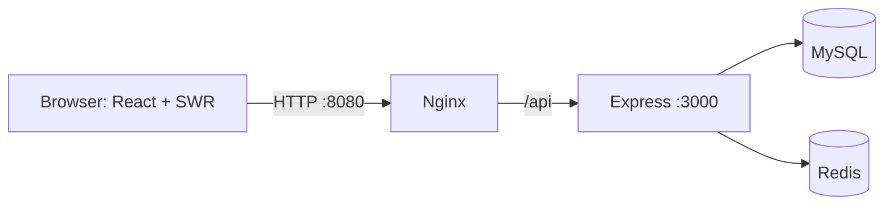
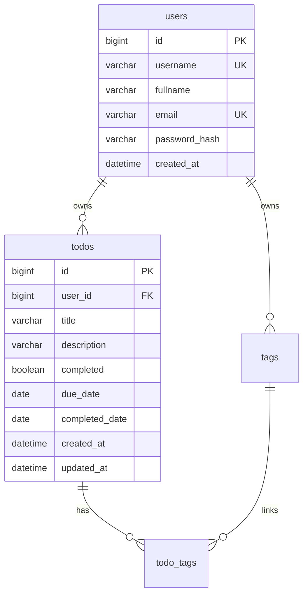

# Todo App — Báo cáo project

Cập nhật theo working tree ngày **21/10/2026**, bao gồm thay đổi chưa commit. Báo cáo mô tả phần đã có mã nguồn; **chưa xác nhận nghiệm thu end-to-end trong lần cập nhật này**. Mốc bàn giao trong kế hoạch ban đầu là 23/10/2026; giờ báo cáo cần xác nhận riêng.

## 1. Mục tiêu và phạm vi

Todo App giúp mỗi tài khoản quản lý công việc cá nhân. Mục tiêu kỹ thuật là triển khai luồng xuyên suốt từ React SPA tới Express, MySQL, xác thực, validation, phân trang, cache và Docker; người thực hiện giải thích được các quyết định và cách kiểm chứng.

| Hạng mục | Hiện trạng theo source |
| --- | --- |
| Tài khoản | Đăng ký, đăng nhập, lấy user hiện tại, đăng xuất |
| Todo | Tạo, danh sách, API chi tiết, sửa, xóa, bật/tắt hoàn thành |
| Ngày nghiệp vụ | Hạn hoàn thành tùy chọn, ngày hoàn thành, nhận diện hoàn thành trễ |
| Tra cứu | Tìm theo tiêu đề; lọc tất cả/chưa hoàn thành/đã hoàn thành/quá hạn |
| Phân trang | LIMIT/OFFSET tại MySQL; frontend 5 item/trang |
| Frontend | SWR, hooks, component riêng, URL state, toast/loading/empty/error |
| Cache backend | Redis cache danh sách và chi tiết, TTL, invalidation, fallback DB |
| Hạ tầng | Compose gồm frontend/backend/MySQL/Redis; Nginx, volume, healthcheck |
| Kiểm thử | Chưa có test suite tự động thực tế; chưa có kết quả nghiệm thu mới |

API chi tiết đã tồn tại nhưng chưa có màn hình chi tiết riêng. tags và todo_tags mới có schema, chưa có API/UI. Admin, chia sẻ, refresh token, quên mật khẩu, CI/CD và public deployment chưa có trong phạm vi đã triển khai.

## 2. Công nghệ

| Thành phần | Công nghệ | Vai trò |
| --- | --- | --- |
| Frontend | React 19, Vite 8, React Router 7 | SPA gọi API, điều hướng và build |
| Server state | SWR 2 | Cache theo query, revalidation sau mutation |
| Giao diện | CSS thuần, Lucide React, Sonner | Responsive, icon, thông báo |
| Backend | Node.js, Express 5 | Route, middleware, nghiệp vụ |
| Validation | Zod 4 | Kiểm tra và chuẩn hóa đầu vào |
| Authentication | jsonwebtoken, cookie-parser, bcryptjs | JWT cookie và hash mật khẩu |
| Database | MySQL, mysql2/promise | Quan hệ user–todo, SQL tham số hóa, connection pool |
| Cache backend | Redis | Cache kết quả đọc |
| Đóng gói | Docker Compose, Nginx | Chạy các dịch vụ bằng cấu hình chung |

Frontend dùng JavaScript ES Modules, backend dùng CommonJS; không dùng ORM. Docker dùng Node 22 Alpine, MySQL 8.4 và Redis 7 Alpine.

## 3. Kiến trúc và trách nhiệm

Nginx phục vụ static frontend, fallback index.html cho SPA và proxy API cùng origin. Development Vite proxy /api tới localhost:3000. Browser không truy cập trực tiếp DB/Redis.

Backend tổ chức controller–service–repository:

- Route nối URL với requireAuth, validation và controller.
- Controller nhận dữ liệu HTTP, gọi service, trả status/JSON.
- Service chứa nghiệp vụ, điều phối repository và cache.
- Repository chứa SQL, không dùng req/res và không quyết định HTTP status.
- Error middleware thống nhất cấu trúc lỗi.
- caches/cache.js cung cấp withCache; caches/todo.cache.js chứa quy tắc key và invalidation.

Đây là backend phân lớp, không phải microservices. Chi tiết: [architecture.md](architecture.md).

## 4. Thiết kế dữ liệu và ngày nghiệp vụ

Migration hiện tại: [001_init.sql](../backend/migrations/001_init.sql).

Quan hệ users–todos được dùng trong ứng dụng; tags–todo_tags chỉ mới có schema.

- ID là BIGINT UNSIGNED AUTO_INCREMENT.
- username/email có unique constraint; service chuyển lỗi trùng thành 409.
- todos.user_id có foreign key tới users với ON DELETE CASCADE.
- title tối đa 200 ký tự; description là VARCHAR(2000), nullable.
- completed mặc định false; API trả boolean.
- due_date/completed_date là DATE, trả dueDate/completedDate dạng YYYY-MM-DD.
- Index idx_todos_user_created gồm (user_id, created_at, id).
- created_at/updated_at là DATETIME(3); connection chưa cấu hình timezone rõ ràng, cần kiểm chứng trước khi khẳng định thống nhất UTC.

SQL tính ngày hiện tại bằng UTC + 7 giờ, frontend dùng Asia/Ho_Chi_Minh. Quá hạn gồm việc chưa hoàn thành có dueDate trước hôm nay và việc đã hoàn thành với completedDate > dueDate. Đây là bộ lọc suy ra, không phải trạng thái enum thứ ba.

Chuyển false → true ghi ngày hoàn thành; gửi true khi đã true giữ ngày cũ; gửi false xóa ngày hoàn thành.

## 5. Xác thực và quyền sở hữu

Đăng ký nhận username, email, password và fullname tùy chọn. Zod chuẩn hóa dữ liệu, service kiểm tra trùng, bcrypt tạo salt cost 10 và hash mật khẩu. Password đăng ký dài 8–72 ký tự và tối đa 72 byte UTF-8. Unique constraint xử lý cả đăng ký trùng đồng thời.

Đăng nhập chuẩn hóa email, dùng bcrypt.compare, tạo JWT hạn một ngày. Cookie token có HttpOnly, SameSite=Lax, Path=/ và Secure khi NODE_ENV=production. JSON trả user, không chứa token hoặc password hash. Đăng ký thành công hiện chỉ xóa form/thông báo, không tự login.

AuthProvider gọi /api/auth/me khi mount và dùng AbortController khi cleanup. /me trả Cache-Control: no-store; không phải refresh token. Logout trả 204, xóa cookie và xóa user/cache SWR phía frontend; chưa thu hồi bản JWT đã bị sao chép.

Mọi endpoint Todo dùng requireAuth, verify JWT với HS256 và lấy req.auth.userId. Danh sách lọc user_id; chi tiết/sửa/xóa lọc id AND user_id. Không tìm thấy hoặc khác chủ đều trả 404. Không nhận user_id từ body để quyết định quyền.

Frontend /todos chưa có ProtectedRoute. Handler 401 xóa user/cache và chuyển login sau phản hồi API; cần bổ sung trạng thái chờ auth và chặn route để hoàn thiện trải nghiệm.

## 6. CRUD, validation, tìm kiếm và phân trang

Luồng tạo: Form validate → todoApi/httpClient → requireAuth → Zod → controller → service kiểm tra user → repository INSERT/SELECT → tăng version cache danh sách → 201 → SWR revalidation và chuyển trang 1.

Todo mới luôn completed=false. Từ khóa/tab hiện tại vẫn được giữ khi tạo, nên item mới không nhất thiết xuất hiện nếu không khớp điều kiện.

PATCH nhận ít nhất một field title/description/dueDate/completed. Schema Todo strict, từ chối field lạ. Xóa có xác nhận UI và trả 204 không body. Error response có dạng { error: { code, message } }; lỗi server dùng thông báo chung và log nội bộ.

Danh sách dùng page, limit, keyword, filterTab; không dùng pageSize. Backend mặc định page=1, limit=5, giới hạn limit 1–20; frontend cố định 5.

- Search khi submit form, SQL title LIKE %keyword%.
- filterTab nhận all/pending/completed/overdue.
- Offset = (page - 1) × limit.
- Sort created_at DESC, id DESC.
- Response: data, pagination { page, limit, totalItems, totalPages }, stats.
- Repository chạy bốn COUNT cho bốn tab và một SELECT lấy trang.
- Stats tính trên toàn bộ kết quả khớp từ khóa của user, không chỉ trang hiện tại.
- q/tab/page được lưu trên URL. Khi sửa/xóa làm trang vượt giới hạn, hook cập nhật URL về trang cuối hợp lệ.

Chưa có EXPLAIN/benchmark. Hiệu quả index, bốn COUNT, LIKE và offset lớn cần được đo. [API contract](api.md) ghi đầy đủ validation, ví dụ và mã lỗi.

## 7. Refactor frontend theo góp ý mentor

| Góp ý/vấn đề | Code hiện tại | Cách kiểm chứng cần làm |
| --- | --- | --- |
| Dùng SWR | useTodos và revalidation trong useTodoMutations | Chuyển query, lỗi mạng, dữ liệu sau mutation |
| Trang quá nhiều trách nhiệm | Tách hooks, api, lib, components/todo | Hồi quy CRUD và UI |
| Render khi nhập liệu | State nằm trong form tạo/sửa và ô search | React DevTools |
| TodoItem nhiều props | 8 props, memo, useCallback cho callback liên quan | Đo profiler, chưa có tỷ lệ cải thiện |
| Hủy request | Timeout 10 giây trong client, AbortController cho /me | Timeout/abort/cleanup |
| Lỗi rải rác | ApiError, errorHandler, banner/toast, sự kiện 401 | Lỗi hệ thống, hết phiên, toast lặp |
| Giữ bộ lọc khi F5 | useTodoQuery lưu URL | F5, Back/Forward |

keepPreviousData đã bật nhưng TodoList vẫn ưu tiên skeleton khi isLoading; cần kiểm thử khi đổi key. SWR key chưa chứa userId; code xóa cache khi logout/401, cần kiểm thử đổi tài khoản.

Login/Register vẫn fetch trực tiếp, chưa dùng chung httpClient/errorHandler. Chưa có optimistic update. Chi tiết: [refactor-plan.md](refactor-plan.md).

## 8. SWR và Redis

SWR cache dữ liệu phục vụ UI; Redis cache kết quả đọc ở backend; MySQL lưu dữ liệu bền vững.

withCache thực hiện cache-aside: tạo key → hit trả Redis → miss đọc DB → lưu kết quả hợp lệ → trả response. Không cache null/undefined.

| Loại | Key | TTL |
| --- | --- | --- |
| Chi tiết | todo:{userId}:{todoId} | Mặc định 60 giây |
| Version danh sách | todos:ver:{userId} | Chưa đặt TTL |
| Dữ liệu danh sách | todos:{userId}:v{version}:{queryHash} | Mặc định 60 giây |

queryHash là 16 ký tự hex đầu của SHA-1 trên [page, limit, keyword, filterTab]. Hash phục vụ key ngắn/ổn định, không phải cơ chế authorization.

- Tạo: ghi DB rồi INCR version danh sách.
- Sửa/xóa: ghi DB rồi DEL chi tiết và INCR version danh sách.
- Key danh sách version cũ tự hết TTL, không quét xóa toàn bộ Redis.
- Frontend gọi mutate/revalidation sau mutation để tải lại dữ liệu.

Redis chưa sẵn sàng/lỗi có đường fallback DB. Client tắt offline queue và có reconnect. server.js không await connect Redis, nhưng Compose chờ Redis healthy trước khi khởi động backend.

TTL không bảo đảm nhất quán tuyệt đối khi invalidation lỗi hoặc đọc/ghi đồng thời. Chưa có số liệu tăng hiệu năng. Log HIT/MISS/DEL/INCR bật khi NODE_ENV=development.

## 9. Docker và khả năng bàn giao

Compose chính chỉ publish frontend 8080:80. Dev override bổ sung MySQL 3307:3306 và NODE_ENV=development cho backend.

- DB_HOST=mysql, REDIS_URL=redis://redis:6379 qua mạng Compose.
- mysql_data giữ dữ liệu; SQL init mount read-only, chỉ tự chạy khi data directory trống.
- MySQL/Redis/backend có healthcheck; backend /health chỉ kiểm tra SELECT 1.
- Backend dùng npm ci --omit=dev, chạy user node.
- Frontend multi-stage build bằng Node rồi phục vụ dist bằng Nginx.
- Nginx hiện chỉ HTTP; production bật Secure cookie, cần kiểm tra theo cách truy cập demo thực tế và cấu hình HTTPS khi triển khai.
- Migration ghi cứng todo_app; không đổi MYSQL_DATABASE độc lập mà chưa đồng bộ SQL.

Hướng dẫn chạy và cấu hình local: [README](../README.md).

## 10. Demo và nghiệm thu

Đây là kịch bản dự kiến, chưa phải kết quả thực thi.

| Tình huống | Kết quả mong đợi |
| --- | --- |
| Register/login/F5 | User đúng, /me khôi phục phiên, không trả hash |
| CRUD và tick hoàn thành | DB/UI đồng bộ, 204 không parse JSON |
| Title/PATCH rỗng, field lạ | 400, không ghi dữ liệu không hợp lệ |
| Search/filter/paging với nhiều trang | Stats đúng phạm vi, trang và URL đúng |
| Xóa item cuối trang cuối | Chuyển về trang cuối hợp lệ |
| B truy cập Todo A | GET/PATCH/DELETE bị 404 kể cả khi cache A đã có |
| Cùng request đọc hai lần | Log miss rồi hit nếu trong TTL |
| Mutation rồi đọc | Cache bị invalidation, luồng tuần tự nhận dữ liệu mới |
| Redis gián đoạn/kết nối lại | Kiểm tra fallback và dữ liệu sau reconnect |
| Logout A, login B | Không hiển thị cache SWR của A |
| Restart và refresh route SPA | DB giữ dữ liệu, Nginx không trả 404 cho route |

Demo Redis cần bảo đảm request tới backend, không chỉ lấy từ SWR. Chi tiết Todo demo bằng API có cookie. Không dùng thao tác xóa volume dữ liệu demo để minh họa.

## 11. Ưu tiên hoàn thiện và bài học

1. Bổ sung test auth/quyền sở hữu, validation, paging và cache; backend npm test còn placeholder.
2. Kiểm thử browser flow, cookie theo môi trường, đổi tài khoản, loading, lỗi mạng.
3. Hoàn thiện ProtectedRoute/chờ auth; cân nhắc SWR key theo user; thống nhất HTTP client cho auth.
4. Thống nhất timezone timestamp, dọn debug log, đo query/cache trước khi tối ưu.
5. Ghi bằng chứng kiểm thử, commit bàn giao và chạy từ môi trường sạch.

Bài học chính: tách trách nhiệm, phân biệt UI state/server state, bảo vệ dữ liệu tại backend, quản lý invalidation backend cùng revalidation frontend.

## 12. Tài liệu liên quan

- [Kiến trúc](architecture.md)
- [API contract](api.md)
- [Use case và sequence diagram](sequence-diagrams.md)
- [Tiến độ và kế hoạch](timeline.md)
- [Refactor frontend](refactor-plan.md)
- [Prompt tạo slide](gemini-slide-prompt.md)

Chỉ chuyển “đã có code” thành “đã nghiệm thu” khi có kết quả thực thi và bằng chứng.
