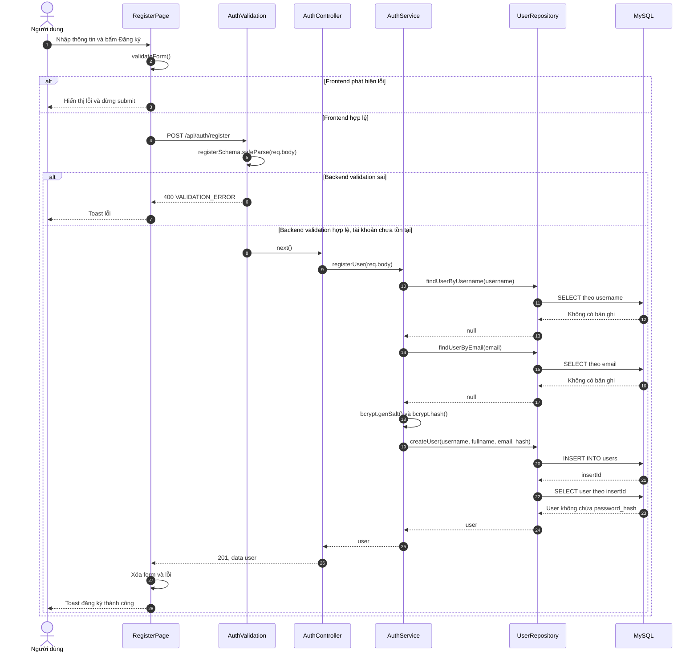
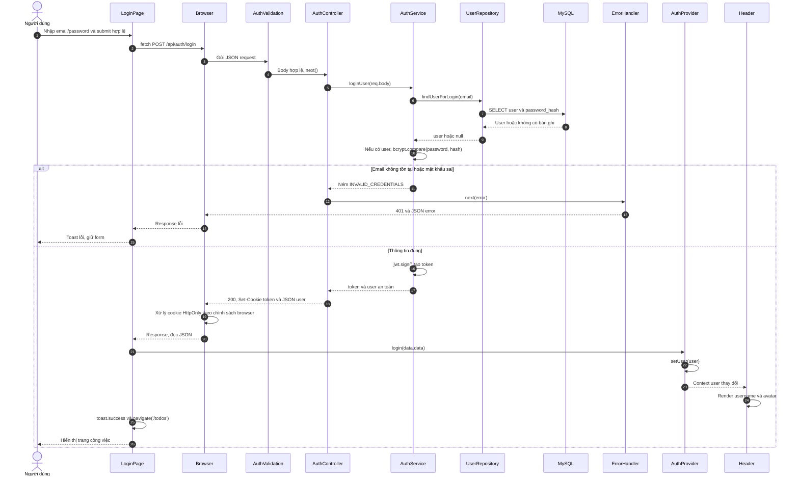
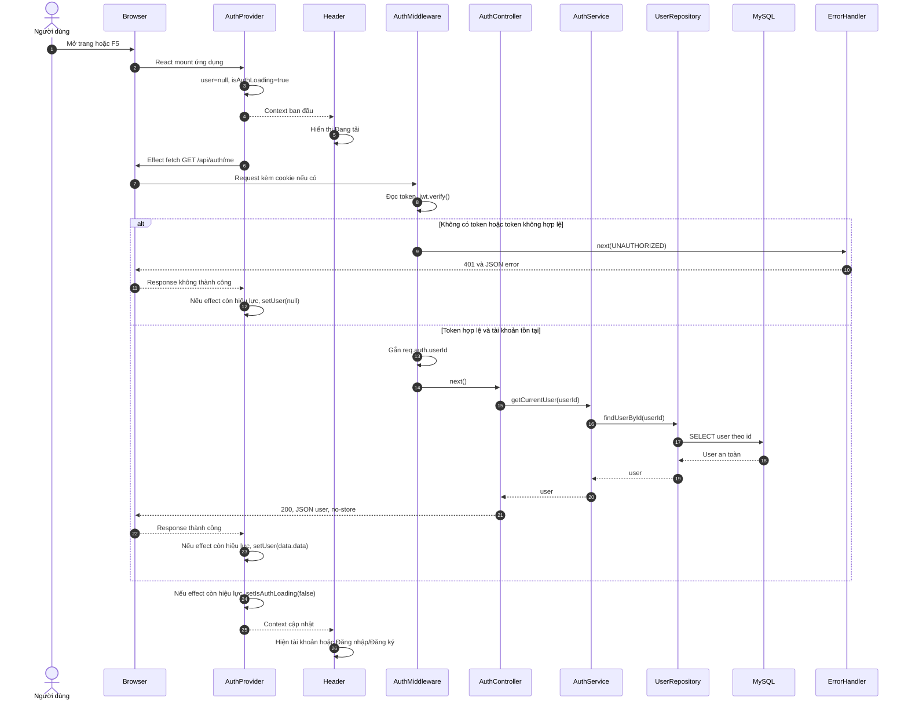
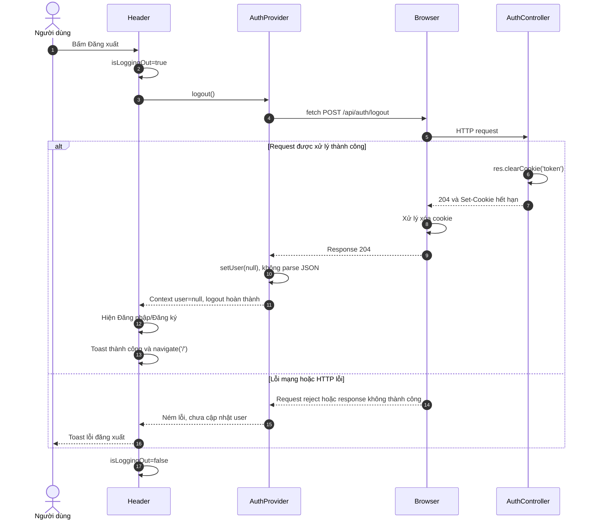
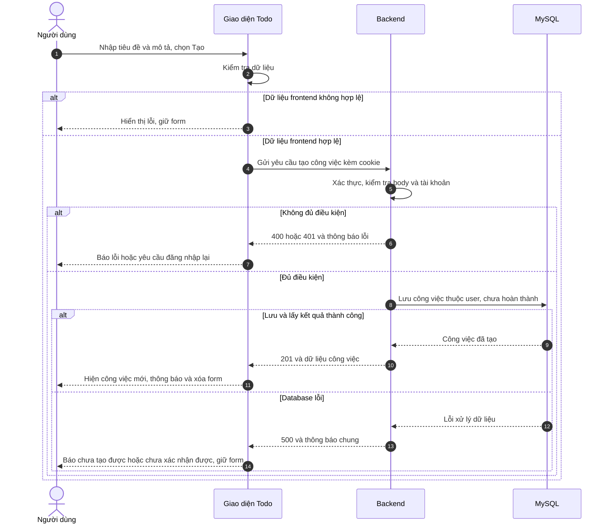

# Todo App — Kế hoạch, thiết kế và tài liệu dự án

Cập nhật: **15/10/2026**. Deadline: **23/10/2026**, giờ Việt Nam (UTC+7).

Đây là bản tổng hợp dùng để gửi mentor và cập nhật tiến độ trong một file. Deadline giờ của từng task là mốc nội bộ; giờ nộp/demo cần mentor xác nhận. Bản này tổng hợp kế hoạch, timeline, kiến trúc, API và các bảng kịch bản/sequence diagram theo mẫu báo cáo đã cung cấp.

**Tiến độ:** phần auth đã có code nhưng còn chờ nghiệm thu end-to-end; Todo hiện dùng dữ liệu mẫu, chưa có API CRUD/paging/cache/Docker. Không xem “có code” là “đã hoàn thành”.

## Mục lục tổng

1. [Yêu cầu, phạm vi và kế hoạch kỹ thuật](#ke-hoach)
2. [Tiến độ và timeline từng task](#timeline)
3. [Kiến trúc và cấu trúc source](#kien-truc)
4. [API contract](#api)
5. [Kịch bản use case và sequence diagram](#sequence)

## Cách cập nhật

- Cập nhật trạng thái, bằng chứng và deadline trong phần 2 cuối mỗi ngày.
- Khi thay đổi API/source, cập nhật các phần 3–5 tương ứng.
- Các mục dự kiến giữ nhãn “chưa implement” cho tới khi có code; chỉ đánh dấu task Xong khi đã kiểm tra.
- Bản tổng hợp này là đầu mối tài liệu từ thời điểm cập nhật; các file riêng trước đó được giữ để tham khảo, không cần sửa đồng thời hai bộ tài liệu.
- Tên file trong cây cấu trúc mô tả vị trí trong project, không phải liên kết ra tài liệu khác.

<a id="ke-hoach"></a>

# 1. Yêu cầu, phạm vi và kế hoạch kỹ thuật

### 1. Mục tiêu và cách đánh giá

Xây dựng một Todo App chạy được từ đầu đến cuối, có frontend SPA, backend, authentication, database và phân trang, validation, xử lý lỗi, caching và Docker.

Khi nộp, gửi link GitHub và chạy ứng dụng để mentor xem. Chưa có yêu cầu bắt buộc deploy lên Internet.

Mentor đánh giá cả source code, cách chạy dự án và khả năng giải thích lựa chọn kỹ thuật. Ngoài ra còn đánh giá cách đặt câu hỏi, trình bày, tự học và giải quyết vấn đề.

#### Những điểm đã rõ

- Tự chọn công nghệ; tận dụng nền tảng React, Next.js, Node.js và Express hiện có.
- Layout là cấu trúc thư mục và cách phân chia trách nhiệm trong source.
- Caching phải được triển khai và giải thích được; không chỉ cài Redis cho có.
- Admin và chia sẻ công việc là phần có thể làm thêm nếu đủ thời gian.
- Docker là lựa chọn mentor đánh giá tích cực và đã nằm trong đề gốc.
- Mentor cho phép tham khảo Internet/ChatGPT để tìm hiểu thêm. Cần tự hiểu code và làm đúng giới hạn sử dụng AI của bài; không suy diễn thành cho phép giao toàn bộ việc viết code cho AI.

#### Giả định để bắt đầu

- Ứng dụng quản lý công việc cá nhân; mỗi tài khoản chỉ truy cập dữ liệu của mình.
- Đăng ký tài khoản được đưa vào phạm vi để mentor tự thử ứng dụng.
- Chưa cần đăng nhập Google, gửi email, quên mật khẩu hoặc refresh token.
- Chạy local bằng Docker là mục tiêu bàn giao; không dành thời gian deploy khi chưa được yêu cầu.
- Lịch cập nhật cần khoảng 37 giờ làm tập trung và 2 giờ dự phòng trong 15–23/10, bao gồm cuối tuần. Nếu không có khoảng 4–5 giờ/ngày ở các ngày triển khai, báo mentor để điều chỉnh. Xem phân bổ ở timeline.


### 2. Phạm vi và thứ tự ưu tiên

#### P0 — cần hoàn thành

- [ ] Đăng ký, đăng nhập và đăng xuất.
- [ ] Bảo vệ API; kiểm tra quyền sở hữu từng todo.
- [ ] Thêm, xem danh sách, xem chi tiết, sửa và xóa todo.
- [ ] Đánh dấu hoàn thành/chưa hoàn thành.
- [ ] Phân trang tại database.
- [ ] Validation ở backend và phản hồi phù hợp trên frontend.
- [ ] Xử lý lỗi tập trung, response lỗi thống nhất.
- [ ] Cache một API đọc, có TTL và invalidation khi dữ liệu thay đổi.
- [ ] Docker Compose chạy frontend, backend, MySQL và Redis.
- [ ] README, cấu hình mẫu, migration và kiểm thử các luồng quan trọng.
- [ ] Demo ổn định và giải thích được source.

#### P1 — bổ sung sau khi P0 ổn định

- [ ] Lọc theo trạng thái hoàn thành.
- [ ] Tìm kiếm theo tiêu đề.
- [ ] Cải thiện giao diện trên màn hình nhỏ.

#### P2 — mở rộng nếu còn thời gian

- Chia sẻ công việc: phải định nghĩa ai được xem/sửa/xóa, điều chỉnh database và kiểm tra quyền truy cập.
- Admin: phải xác định nghiệp vụ cụ thể, không chỉ thêm trường `role`.
- Deploy, CI hoặc tài liệu API tự động.

Không bắt đầu P2 trước khi toàn bộ P0 chạy được và đã kiểm tra. Nếu thêm quyền truy cập mới, phải đánh giá lại thiết kế cache.


### 3. Stack dự kiến và lý do

| Thành phần | Lựa chọn | Lý do |
|---|---|---|
| Frontend | React + Vite | Tận dụng kiến thức React, làm SPA gọi API riêng |
| Backend | Node.js + Express | Đã có nền tảng; chủ động tổ chức routes, middleware và nghiệp vụ |
| Ngôn ngữ | JavaScript (CommonJS) | Phù hợp nền tảng Node.js hiện tại của người thực hiện; dùng nhất quán `require`/`module.exports` |
| Database | MySQL (InnoDB) | Đã có kinh nghiệm sử dụng; phù hợp quan hệ user–todo, khóa ngoại và phân trang |
| Truy cập database | `mysql2/promise`, connection pool và prepared statements qua `execute()` | Dùng async/await, dễ giải thích SQL; truyền giá trị qua placeholder `?`, không nối chuỗi dữ liệu người dùng vào SQL |
| Cache | Redis | Minh họa cache độc lập, TTL và xóa cache |
| Authentication | JWT trong HttpOnly cookie, hạn hiện tại 1 ngày | Backend xác minh cookie; frontend Context giữ thông tin user |
| Môi trường chạy | Docker Compose | Chạy nhiều dịch vụ bằng cấu hình chung |

Project đã chốt JavaScript. Backend dùng CommonJS (`require`/`module.exports`); frontend React/Vite vẫn dùng ES Modules (`import`/`export`). Không trộn hai module system trong cùng một phần của project.

Chốt một thư viện validation, một thư viện hash mật khẩu và một công cụ migration trong ngày đầu. Đọc tài liệu chính thức, dùng phiên bản tương thích, giữ lockfile và không thay stack giữa chừng nếu chưa có vấn đề cụ thể.

Next.js vẫn là công nghệ có thể dùng, nhưng kế hoạch hiện tại chọn React SPA và Express riêng để làm rõ yêu cầu frontend/backend. Không cần chuyển sang NestJS chỉ để có cấu trúc thư mục.


### 5. Thiết kế database

#### Bảng `users`

| Trường | Quy tắc |
|---|---|
| `id` | `BIGINT UNSIGNED AUTO_INCREMENT`, khóa chính |
| `username` | Bắt buộc, 3–50 ký tự, chữ/số/gạch dưới, unique; code hiện trim, chưa tự chuyển chữ thường |
| `fullname` | Không bắt buộc, tối đa 100 ký tự, có thể `NULL` |
| `email` | Bắt buộc, chuẩn hóa nhất quán, unique |
| `password_hash` | Chỉ lưu hash; không lưu hoặc trả password gốc |
| `created_at` | `DATETIME(3)`, thống nhất ghi/đọc theo UTC |

#### Bảng `todos`

| Trường | Quy tắc |
|---|---|
| `id` | `BIGINT UNSIGNED AUTO_INCREMENT`, khóa chính |
| `user_id` | `BIGINT UNSIGNED`, khóa ngoại tới `users.id`, bắt buộc |
| `title` | Sau trim: 1–200 ký tự |
| `description` | Không bắt buộc, tối đa 2.000 ký tự ở lớp validation |
| `completed` | `BOOLEAN` (MySQL biểu diễn bằng `TINYINT(1)`), mặc định false; API trả boolean |
| `created_at` | `DATETIME(3)`, thống nhất ghi/đọc theo UTC |
| `updated_at` | `DATETIME(3)`, cập nhật theo UTC khi sửa |

- Tạo migration thay vì yêu cầu mentor tự tạo bảng thủ công.
- Dùng InnoDB và charset `utf8mb4` để hỗ trợ khóa ngoại và nội dung tiếng Việt.
- `DATETIME` không tự lưu thông tin múi giờ; cấu hình backend và connection database theo UTC, trả ngày giờ ISO 8601 và đổi sang giờ địa phương ở frontend.
- Dùng index phục vụ truy vấn theo user và thứ tự danh sách, ví dụ `(user_id, created_at DESC, id DESC)`.
- Mọi truy vấn dữ liệu riêng phải gắn với user đã xác thực.
- Bắt lỗi duplicate key (`ER_DUP_ENTRY`) của email và chuyển thành lỗi nghiệp vụ phù hợp.
- Validation hiện tại: 8–72 ký tự; cần bổ sung kiểm tra tối đa 72 byte UTF-8 theo giới hạn bcrypt. Không tự cắt hoặc trim mật khẩu.


### 8. Caching: kế hoạch triển khai và chứng minh

#### Mục tiêu học

Hiểu cache-aside, cache hit/miss, TTL, invalidation và các trường hợp dữ liệu cũ. App nhỏ chưa chắc cần cache để đạt hiệu năng; triển khai một luồng có phạm vi rõ để thể hiện kỹ thuật, không tuyên bố tăng tốc khi chưa đo.

#### Phạm vi

Cache `GET /api/todos/:id`, chưa cache danh sách để tránh quản lý nhiều biến thể trang và bộ lọc.

- Key: `todo:{authenticatedUserId}:{todoId}`.
- Value: dữ liệu todo được phép trả cho user đó.
- TTL khởi đầu: 60 giây, cấu hình được.
- Không cache thông tin đăng nhập hoặc password hash.

#### Luồng đọc

1. Xác thực token và validate todo ID.
2. Tạo key từ user đã xác thực, không lấy user từ request body.
3. Nếu Redis có dữ liệu hợp lệ, trả dữ liệu và ghi log cache hit trong chế độ phát triển.
4. Nếu cache miss, truy vấn database với cả `id` và `user_id`.
5. Không tìm thấy thì trả 404; không cache dữ liệu của người khác.
6. Tìm thấy thì lưu Redis với TTL rồi trả response.
7. Nếu Redis lỗi, truy vấn database, log lỗi cache và tiếp tục phục vụ nếu database vẫn hoạt động.

#### Luồng ghi

1. Sửa/xóa trong database, đồng thời kiểm tra quyền sở hữu.
2. Sau khi ghi thành công, xóa key tương ứng khỏi Redis.
3. Lần đọc tiếp theo lấy dữ liệu mới từ database.

Giới hạn cần hiểu: TTL giới hạn tuổi dữ liệu cache, không bảo đảm đồng bộ tức thời. Nếu invalidation thất bại hoặc read/write diễn ra đồng thời, vẫn có khả năng đọc dữ liệu cũ. Ghi nhận giới hạn, dùng TTL ngắn và demo luồng tuần tự đúng; không tuyên bố cache bảo đảm nhất quán tuyệt đối. Nếu mở rộng chia sẻ quyền, cache cần được đánh giá lại để tránh quyền đã thu hồi vẫn truy cập dữ liệu.

#### Bằng chứng demo

- [ ] Đọc todo lần đầu: log miss và truy vấn database.
- [ ] Đọc lại: log hit, không chạy truy vấn lấy todo lần nữa.
- [ ] Sửa todo rồi đọc: thấy dữ liệu mới.
- [ ] Xóa todo rồi đọc: nhận 404.
- [ ] User B đọc ID của user A khi cache đã có: vẫn nhận 404.
- [ ] TTL hết hạn: đọc lại phát sinh miss.
- [ ] Tắt Redis: backend vẫn đọc dữ liệu từ database sau khoảng timeout hợp lý.


### 10. Docker và bàn giao

Compose có bốn service: frontend, backend, MySQL, Redis.

- [ ] Frontend được build thành static assets và phục vụ bằng web server, hỗ trợ fallback cho route SPA.
- [ ] Proxy `/api` tới backend để dùng cùng origin khi chạy Compose.
- [ ] Backend kết nối database/cache bằng service name, không dùng `localhost` của host bên trong container.
- [ ] MySQL có volume gắn vào `/var/lib/mysql` để giữ dữ liệu qua restart.
- [ ] Backend dùng tài khoản MySQL riêng với quyền phù hợp, không dùng tài khoản root; cấu hình host, port, database, user và password qua biến môi trường.
- [ ] Có healthcheck và xử lý phụ thuộc chưa sẵn sàng; không mặc định thứ tự start là dịch vụ đã ready.
- [ ] Có bước migration rõ ràng, không yêu cầu sửa database thủ công.
- [ ] Không bake secret vào image; cấu hình qua biến môi trường.
- [ ] Có `.dockerignore` và lockfile.
- [ ] README ghi lệnh cấu hình, build/start, migration, xem log và stop.
- [ ] Phân biệt stop/restart với lệnh xóa volume; tránh vô tình mất dữ liệu demo.

Mục tiêu: mentor clone repo, làm theo README và chạy được ứng dụng mà không phải đoán bước còn thiếu.


### 12. Kiểm thử và tiêu chí hoàn thành

Ưu tiên integration test cho API bằng công cụ phù hợp, ví dụ Supertest và test runner đã chọn. Dùng database/cache test riêng; không xóa dữ liệu demo bằng bài test.

| Nhóm | Trường hợp quan trọng |
|---|---|
| Tài khoản | Email trùng, mật khẩu sai, token sai/hết hạn, không trả hash |
| Quyền | A không đọc/sửa/xóa todo B; thử cả khi cache đã được tạo |
| Validation | Title rỗng/quá dài, ID số nguyên dương sai, page sai, pageSize vượt giới hạn, PATCH rỗng |
| CRUD | Tạo–đọc–sửa–xóa, ID không tồn tại, completed phải là boolean |
| Paging | Nhiều hơn một trang, trang rỗng, thứ tự ổn định, không lẫn dữ liệu user |
| Cache | Hit/miss, TTL, invalidation, Redis lỗi, giới hạn nhất quán được ghi nhận |
| Frontend | Lỗi mạng, 401, submit lặp, xóa item cuối trang, response 204 |
| Docker | Chạy từ đầu, migration, refresh route SPA, restart vẫn giữ DB |

Một chức năng được xem là xong khi chạy đúng luồng chính, xử lý trường hợp lỗi liên quan, không phá quyền truy cập, và người làm giải thích được code. Không chỉ đánh dấu xong vì đã có file hoặc endpoint.


### 13. README và thói quen làm việc

README cuối cùng cần có:

- [ ] Giới thiệu, phạm vi và tính năng.
- [ ] Stack và lý do chọn ngắn gọn.
- [ ] Yêu cầu môi trường, biến môi trường và cách khởi chạy.
- [ ] Migration, tạo tài khoản/demo data và cách chạy kiểm thử.
- [ ] Cấu trúc source, schema database và API chính.
- [ ] Thiết kế caching và cách xem bằng chứng hit/miss.
- [ ] Giới hạn authentication/cache và phần chưa làm.
- [ ] Lỗi khởi chạy thường gặp và cách xử lý.

Mỗi ngày ghi 3–5 dòng: đã làm gì, gặp lỗi gì, tìm ra nguyên nhân thế nào, kiểm chứng ra sao, bước tiếp theo. Commit theo một thay đổi có ý nghĩa; không commit `.env`, secret, dependency hoặc dữ liệu cá nhân.

Khi dùng tài liệu/ChatGPT để học, tự chạy ví dụ nhỏ và giải thích lại bằng lời của mình. Nếu không hiểu đoạn code, chưa xem phần đó là hoàn thành.


### 14. Kịch bản demo và Q&A

#### Demo dự kiến 10–15 phút

1. Nêu phạm vi, stack và cấu trúc project trong 1–2 phút.
2. Chạy theo README, mở app và đăng nhập.
3. Tạo, xem chi tiết, sửa, đánh dấu hoàn thành và xóa todo.
4. Thử dữ liệu sai và phân trang.
5. Dùng tài khoản khác chứng minh quyền sở hữu.
6. Minh họa cache miss → hit → sửa dữ liệu → đọc mới.
7. Mở source giải thích một request đi qua routes/controller/service/repository/cache.
8. Nêu giới hạn hiện tại và hướng cải thiện.

Không tuyên bố lợi ích hiệu năng bằng số liệu chưa đo. Nếu gặp lỗi demo, mô tả hiện tượng, kiểm tra log và giải thích hướng xử lý.

#### Câu hỏi tự luyện

- Vì sao chọn React/Express và cách tổ chức source này?
- Controller và service khác nhau ở trách nhiệm nào?
- Validation frontend khác backend thế nào?
- Authentication khác authorization ra sao?
- Vì sao SQL cần tham số hóa? Unique constraint giúp gì?
- LIMIT/OFFSET hoạt động thế nào, có hạn chế gì?
- Khi nào cache đáng dùng? TTL có thay thế invalidation không?
- Vì sao cache key chứa user ID? Khi Redis lỗi thì app làm gì?
- Đăng xuất có thu hồi JWT không? Vì sao refresh mất React state nhưng /me có thể khôi phục user?
- Docker image, container, network và volume làm gì trong app?
- Khó khăn thực tế nhất là gì, đã tìm nguyên nhân và kiểm chứng cách sửa ra sao?


### 15. Tài liệu tham khảo chính thức

Đọc theo vấn đề đang triển khai, không cần học hết tài liệu trước khi bắt đầu.

- [React: Build a React app from scratch](https://react.dev/learn/build-a-react-app-from-scratch) — khởi tạo frontend với build tool như Vite.
- [Express: Error handling](https://expressjs.com/en/5x/guide/error-handling/) — middleware lỗi và hành vi theo phiên bản Express.
- [MySQL2](https://github.com/sidorares/node-mysql2) — driver Node.js, Promise API, connection pool và prepared statements.
- [MySQL: Foreign key constraints](https://dev.mysql.com/doc/refman/8.0/en/create-table-foreign-keys.html) — khóa ngoại và yêu cầu của các cột tham chiếu.
- [Redis: EXPIRE](https://redis.io/docs/latest/commands/EXPIRE/) — thời hạn sống của key.
- [Redis: DEL](https://redis.io/docs/latest/commands/del/) — xóa key khi invalidation.
- [Docker Compose quickstart](https://docs.docker.com/compose/gettingstarted/) — cấu hình và chạy nhiều dịch vụ.


<a id="timeline"></a>

# 2. Tiến độ và timeline từng task

### 1. Mục tiêu bàn giao

Gửi link GitHub và demo React SPA + Express + MySQL, gồm authentication, CRUD Todo cá nhân, validation/error handling, phân trang, caching và Docker. Người khác chạy được theo README và người thực hiện giải thích được luồng code.

Phạm vi ưu tiên: mỗi user quản lý Todo riêng; `title`, `description`, `completed`. Admin, chia sẻ công việc, refresh token, quên mật khẩu, tìm kiếm và deploy Internet để sau bản bắt buộc. Hai trạng thái Todo: chưa hoàn thành/đã hoàn thành.

### 2. Tiến độ theo source ngày 15/10

Đây là rà soát source, không phải xác nhận đã test toàn bộ trên môi trường sạch. Chỉ chuyển sang “Xong” khi có bằng chứng kiểm tra.

| Hạng mục                                     | Trạng thái hiện tại                            | Còn thiếu                                              |
| -------------------------------------------- | ---------------------------------------------- | ------------------------------------------------------ |
| React SPA, React Router, giao diện home/auth | Có code                                        | Kiểm tra lại toàn luồng và màn hình nhỏ                |
| Express theo controller–service–repository   | Có code                                        | Giữ thống nhất khi thêm Todo                           |
| MySQL, bảng users/todos, migration 001/002   | Có file migration; đã kết nối ở các lượt trước | Chạy lại từ database sạch và đối chiếu schema          |
| Register/login/JWT HttpOnly cookie           | Có code, chờ nghiệm thu                        | Test hợp lệ/sai/trùng, bỏ log mật khẩu                 |
| `/me`, logout, Context và Header             | Có code, chờ nghiệm thu                        | Test F5, cookie hết hạn/sai, logout 204                |
| Bảo vệ trang `/todos`                        | Chưa có ProtectedRoute trong App hiện tại      | Thêm chặn giao diện; bảo vệ API độc lập                |
| Todo frontend                                | Demo bằng state, dùng content/status           | Đổi sang title/description/completed và gọi API        |
| CRUD API Todo, quyền sở hữu                  | Chưa có                                        | Xây dựng và test hai tài khoản                         |
| Paging                                       | Chưa có                                        | LIMIT/OFFSET, total và điều khiển trang                |
| Cache Redis                                  | Chưa có                                        | Cache-aside chi tiết Todo, TTL, invalidation, fallback |
| Docker                                       | Chưa có                                        | Frontend/backend/MySQL/Redis và cách chạy migration    |
| Test tự động                                 | Chưa có suite thực tế                          | Backend script test hiện là placeholder                |
| Docs                                         | Có API và architecture ban đầu                 | Đồng bộ source, README, bằng chứng và demo             |

### 3. Năng lực thời gian và phụ thuộc

Ước lượng khoảng **37 giờ làm việc tập trung**, cộng **2 giờ dự phòng**, trong 15–23/10. Cần khoảng 4–5 giờ/ngày ở các ngày triển khai; bao gồm cả cuối tuần 17–18/10. Đây là giả định lập lịch, chưa phải thời gian người thực hiện đã cam kết. Nếu không đủ thời gian, báo mentor ngay trong ngày 15/10 để điều chỉnh.

Làm frontend trước theo từng luồng: chốt contract → làm UI nhỏ → backend tương ứng → nối API → kiểm tra. Tránh làm hết UI rồi mới bắt đầu toàn bộ backend.

```text
Chốt auth và contract Todo
→ UI danh sách/tạo → API danh sách/tạo → tích hợp
→ UI sửa/xóa/chi tiết → API tương ứng → kiểm tra quyền
→ paging → caching → Docker → kiểm thử sạch → demo
```

Các task dưới đây chưa được đánh dấu xong, kể cả task đã có một phần code. “Đang làm” là chặng hiện tại; còn lại là “Chưa làm”. Ước lượng gồm tự học và kiểm tra cơ bản; kiểm thử hồi quy có chặng riêng.

### 4. Task nhỏ và deadline

#### 15/10 — chốt auth và phạm vi (4 giờ)

| ID  | Task                                                                                      | Ước lượng | Phụ thuộc             | Deadline    | Trạng thái | Điều kiện xong                                                                      |
| --- | ----------------------------------------------------------------------------------------- | --------: | --------------------- | ----------- | ---------- | ----------------------------------------------------------------------------------- |
| A01 | Test register: thiếu fullname, thiếu username, trùng email/username; bỏ log chứa password |        1h | Code register hiện có | 15/10 17:00 | Đang làm   | 201/400/409 đúng; DB lưu hash; fullname rỗng là NULL                                |
| A02 | Test login, Context, Header, F5 và logout; sửa lỗi tìm thấy                               |      1.5h | A01                   | 15/10 19:00 | Đang làm   | Login đổi Header ngay; F5 gọi me; logout 204 không parse JSON; me sau logout là 401 |
| A03 | Thêm ProtectedRoute và test chưa đăng nhập mở `/todos`                                    |      0.5h | A02                   | 15/10 20:00 | Chưa làm   | Chờ kiểm tra phiên; chưa login chuyển /login; ghi rõ API phải tự bảo vệ             |
| A04 | Chốt contract Todo hai trạng thái, gửi plan và xin review mentor                          |        1h | A02                   | 15/10 21:00 | Chưa làm   | API fields thống nhất với DB; mentor nhận được plan/link source                     |

#### 16/10 — xem và tạo Todo (5 giờ)

| ID  | Task                                                                            | Ước lượng | Phụ thuộc | Deadline    | Trạng thái | Điều kiện xong                                              |
| --- | ------------------------------------------------------------------------------- | --------: | --------- | ----------- | ---------- | ----------------------------------------------------------- |
| T01 | Đổi UI content/status thành title/description/completed; form và danh sách demo |        1h | A04       | 16/10 12:00 | Chưa làm   | UI dùng đúng fields; xác định loading/empty/error           |
| T02 | Tạo Todo router/controller/service/repository/validation; gắn requireAuth       |        1h | A02, A04  | 16/10 15:00 | Chưa làm   | Toàn bộ /api/todos bắt đăng nhập; không lấy user_id từ body |
| T03 | Làm POST /todos và GET /todos theo user                                         |      1.5h | T02       | 16/10 18:00 | Chưa làm   | Tạo 201, list 200; user B không thấy Todo A                 |
| T04 | Nối UI với hai API; xử lý submit lặp, 401, lỗi và reload trang                  |        1h | T01, T03  | 16/10 20:00 | Chưa làm   | Bỏ dataDemo khỏi luồng thật; F5 vẫn thấy dữ liệu đã lưu     |
| T05 | Lưu kết quả kiểm tra và commit luồng list/create                                |      0.5h | T04       | 16/10 21:00 | Chưa làm   | Có ghi chú request/response và commit chạy được             |

#### 17/10 — chi tiết, sửa, hoàn thành, xóa (5 giờ)

| ID  | Task                                                | Ước lượng | Phụ thuộc | Deadline    | Trạng thái | Điều kiện xong                                                                 |
| --- | --------------------------------------------------- | --------: | --------- | ----------- | ---------- | ------------------------------------------------------------------------------ |
| T06 | Làm UI chi tiết, lưu/hủy chỉnh sửa và xác nhận xóa  |        1h | T04       | 17/10 12:00 | Chưa làm   | UI đủ thao tác, state không sửa trực tiếp object cũ                            |
| T07 | GET /todos/:id và PATCH title/description/completed |      1.5h | T03       | 17/10 16:00 | Chưa làm   | Query theo id + user_id; 404 khi không thuộc user; PATCH rỗng/sai kiểu bị chặn |
| T08 | DELETE /todos/:id và nối các thao tác UI            |        1h | T06, T07  | 17/10 18:00 | Chưa làm   | Xóa trả 204; frontend không gọi json() cho 204; UI cập nhật đúng               |
| T09 | Test hai tài khoản với đọc/sửa/xóa ID của nhau      |        1h | T08       | 17/10 20:00 | Chưa làm   | Tất cả bị chặn; Todo của chủ sở hữu không bị thay đổi                          |
| T10 | Demo CRUD ngắn, cập nhật docs và commit             |      0.5h | T09       | 17/10 21:00 | Chưa làm   | Demo từ login tới CRUD có dữ liệu MySQL                                        |

#### 18/10 — phân trang và độ ổn định UI (4 giờ)

| ID  | Task                                                               | Ước lượng | Phụ thuộc     | Deadline    | Trạng thái | Điều kiện xong                                                             |
| --- | ------------------------------------------------------------------ | --------: | ------------- | ----------- | ---------- | -------------------------------------------------------------------------- |
| P01 | Làm UI trang trước/sau và trạng thái hiện tại                      |      0.5h | T04           | 18/10 12:00 | Chưa làm   | Có page/pageSize và trạng thái vô hiệu nút                                 |
| P02 | Backend validate page/pageSize, COUNT và LIMIT/OFFSET              |      1.5h | T03           | 18/10 16:00 | Chưa làm   | Total chỉ của user; ORDER BY created_at DESC, id DESC; pageSize tối đa 100 |
| P03 | Nối UI; xử lý response cũ, trang rỗng và xóa item cuối trang       |        1h | P01, P02, T08 | 18/10 19:00 | Chưa làm   | Đổi trang nhanh không ghi đè dữ liệu sai; không kẹt trang cuối rỗng        |
| P04 | Kiểm tra với hơn 2 trang dữ liệu, đọc EXPLAIN và xin mentor review |        1h | P03           | 18/10 21:00 | Chưa làm   | Có ví dụ paging và giải thích được index; ghi nhận góp ý                   |

#### 19/10 — caching (5 giờ)

| ID  | Task                                                             | Ước lượng | Phụ thuộc | Deadline    | Trạng thái | Điều kiện xong                                                                           |
| --- | ---------------------------------------------------------------- | --------: | --------- | ----------- | ---------- | ---------------------------------------------------------------------------------------- |
| C01 | Tự học cache-aside/TTL/invalidation, ghi phương án và chạy Redis |        1h | T10       | 19/10 12:00 | Chưa làm   | Chốt cache GET chi tiết; key chứa userId + todoId; TTL 60s                               |
| C02 | Implement cache hit/miss cho GET /todos/:id                      |      1.5h | C01, T07  | 19/10 16:00 | Chưa làm   | Request đầu đọc DB, lần sau hit cache; không cache password/hash                         |
| C03 | Xóa key sau PATCH/DELETE; fallback DB khi Redis lỗi              |        1h | C02, T08  | 19/10 18:00 | Chưa làm   | Mutation rồi đọc không nhận dữ liệu cũ trong luồng tuần tự; Redis lỗi không treo request |
| C04 | Test TTL, quyền user khác, Redis tắt; ghi bằng chứng             |        1h | C03       | 19/10 20:00 | Chưa làm   | Có log hit/miss; user B không nhận cache của A                                           |
| C05 | Demo caching và nhờ mentor review cách apply                     |      0.5h | C04       | 19/10 21:00 | Chưa làm   | Giải thích được lợi ích, chi phí và giới hạn nhất quán                                   |

#### 20/10 — Docker (5 giờ)

Kiểm tra Docker Desktop/Engine có chạy được ngay trong task A04 ngày 15/10; nếu bị chặn cài đặt/quyền, nhờ mentor hỗ trợ sớm.

| ID  | Task                                                      | Ước lượng | Phụ thuộc | Deadline    | Trạng thái | Điều kiện xong                                                                        |
| --- | --------------------------------------------------------- | --------: | --------- | ----------- | ---------- | ------------------------------------------------------------------------------------- |
| D01 | Dockerfile backend, .dockerignore và cấu hình env         |        1h | C04       | 20/10 12:00 | Chưa làm   | Backend chạy bằng node; secret không nằm trong image                                  |
| D02 | Build frontend + Nginx, proxy /api và fallback SPA        |        1h | T10       | 20/10 15:00 | Chưa làm   | Refresh /login, /register, /todos không bị 404 server                                 |
| D03 | Compose frontend/backend/MySQL/Redis; volume, healthcheck |      1.5h | D01, D02  | 20/10 18:00 | Chưa làm   | Service name đúng; database ready; không phụ thuộc MySQL host                         |
| D04 | Chạy migration 001 rồi 002 trên DB sạch; test restart     |        1h | D03       | 20/10 20:00 | Chưa làm   | Có cách chạy migration được ghi lại; restart giữ dữ liệu; tránh chạy lại 002 mù quáng |
| D05 | Ghi hướng dẫn Compose, demo và commit                     |      0.5h | D04       | 20/10 21:00 | Chưa làm   | Người khác biết cấu hình, start, migration, log, stop                                 |

#### 21/10 — kiểm thử và sửa lỗi (4 giờ)

| ID  | Task                                                            | Ước lượng | Phụ thuộc | Deadline    | Trạng thái | Điều kiện xong                                                             |
| --- | --------------------------------------------------------------- | --------: | --------- | ----------- | ---------- | -------------------------------------------------------------------------- |
| Q01 | Tạo môi trường test riêng và test auth/quyền sở hữu tự động     |      1.5h | T09, D04  | 21/10 15:00 | Chưa làm   | Không có cookie/token sai bị 401; A không đọc/sửa/xóa B; không xóa DB demo |
| Q02 | Test validation, paging và cache tự động ở các nhánh quan trọng |        1h | P04, C04  | 21/10 18:00 | Chưa làm   | Lệnh test thật chạy được; invalidation và lỗi đầu vào có kiểm tra          |
| Q03 | Chạy browser flow, build/lint/test; sửa lỗi chặn demo           |      1.5h | Q01, Q02  | 21/10 21:00 | Chưa làm   | Có bằng chứng pass/fail; lỗi còn lại được ghi rõ                           |

#### 22/10 — tài liệu, môi trường sạch và demo thử (4 giờ + 2 giờ dự phòng)

| ID  | Task                                                       | Ước lượng | Phụ thuộc      | Deadline    | Trạng thái | Điều kiện xong                                                               |
| --- | ---------------------------------------------------------- | --------: | -------------- | ----------- | ---------- | ---------------------------------------------------------------------------- |
| R01 | README, .env.example, API và architecture khớp source cuối |        1h | D05, Q03       | 22/10 12:00 | Chưa làm   | Không còn docs mô tả Bearer token/UUID sai với code                          |
| R02 | Clone vào thư mục khác và chạy đúng README với DB riêng    |        1h | R01            | 22/10 15:00 | Chưa làm   | Không cần file env/DB/Redis sẵn từ máy phát triển                            |
| R03 | Demo thử 10–15 phút với mentor, hỏi điểm cần sửa           |      0.5h | R02            | 22/10 17:00 | Chưa làm   | Có góp ý cụ thể; xác nhận giờ demo 23/10                                     |
| R04 | Sửa lỗi cuối, luyện Q&A và chốt commit nộp                 |      1.5h | R03            | 22/10 19:00 | Chưa làm   | Giải thích được auth/SQL/index/paging/cache/Docker; không thêm chức năng lớn |
| B01 | Dự phòng lỗi phát sinh hoặc phản hồi mentor                |        2h | Theo phát sinh | 22/10 21:00 | Chưa dùng  | Nếu không phát sinh thì nghỉ/kiểm tra demo; không tự mở scope                |

#### 23/10 — bàn giao (1 giờ, chưa gồm thời gian mentor đánh giá)

| ID  | Task                                                                 | Ước lượng | Phụ thuộc | Deadline                        | Trạng thái | Điều kiện xong                                       |
| --- | -------------------------------------------------------------------- | --------: | --------- | ------------------------------- | ---------- | ---------------------------------------------------- |
| H01 | Kiểm tra link GitHub, quyền mentor, commit, cấu hình và dữ liệu demo |      0.5h | R04       | 23/10 09:00 (nội bộ)            | Chưa làm   | Mentor mở source được; không có secret; app sẵn sàng |
| H02 | Gửi link repo/commit và demo                                         |      0.5h | H01       | 23/10, theo giờ mentor xác nhận | Chưa làm   | Đã bàn giao và demo; ghi hạn chế còn lại trung thực  |

Nếu giờ mentor hẹn sớm hơn mốc nội bộ, chuyển H01 và chuẩn bị dữ liệu sang tối 22/10.

### 5. Mốc review và hỗ trợ từ mentor

| Mốc   | Nội dung gửi/xin review                           | Cần chuẩn bị trước                                             |
| ----- | ------------------------------------------------- | -------------------------------------------------------------- |
| 15/10 | Timeline có phù hợp không? Review auth và 3-layer | Demo login/F5/logout, diagram request, danh sách chỗ chưa hiểu |
| 18/10 | Review CRUD, quyền sở hữu, paging và index        | Hai tài khoản, ví dụ ID của user khác, EXPLAIN                 |
| 19/10 | Review cách apply caching                         | Log miss/hit, TTL, đọc sau sửa/xóa, khi Redis tắt              |
| 22/10 | Demo thử và chốt bàn giao                         | Chạy từ clone sạch, README, test report, hạn chế hiện tại      |

Nếu mentor bận, gửi câu hỏi kèm code/commit và tiếp tục task độc lập. Không coi chưa được review là hoàn thành; ghi “Chờ review”.

### 6. Quy tắc xử lý chậm tiến độ

- Kẹt một vấn đề hơn 45–60 phút: ghi hiện tượng, log không chứa secret, điều đã thử, giả thuyết; nhờ mentor giúp đúng điểm đó.
- Cuối 17/10 chưa xong CRUD: bỏ toàn bộ phần tùy chọn và báo mentor; không âm thầm dồn Docker/test sang ngày nộp.
- Cuối 19/10 chưa có cache demo: nhờ review trực tiếp, giữ phạm vi chỉ cache chi tiết, không cache toàn bộ danh sách.
- Hết 20/10 chưa chạy được Compose: ưu tiên Docker và khởi chạy sạch; báo rủi ro bàn giao ngay.
- Không cắt quyền truy cập, validation backend, paging, caching hoặc Docker vì đây là yêu cầu đề. Nếu không thể hoàn thành, trao đổi phạm vi với mentor trước.
- Sau 22/10 19:00 chỉ sửa lỗi ảnh hưởng demo/bàn giao.

### 7. Định nghĩa hoàn thành và bằng chứng

Kịch bản use case và biểu đồ tuần tự theo dõi tại [sequence-diagrams.md](#sequence). A04/T10/R01 cần cập nhật diagram tương ứng khi chốt hoặc thay đổi luồng; không coi có diagram là đã kiểm thử.

Một task chỉ “Xong” khi code chạy được, đã kiểm tra điều kiện xong, người thực hiện hiểu code và ghi bằng chứng. Bằng chứng có thể là commit, request/response đã che thông tin nhạy cảm, kết quả test hoặc ghi chú demo. Có file hoặc build pass chưa đủ chứng minh nghiệp vụ đúng.

Trạng thái dùng thống nhất: Chưa làm → Đang làm → Chờ kiểm tra/review → Xong; nếu bị cản thì ghi Bị chặn và nguyên nhân.

| Task ID | Bằng chứng/commit | Kết quả kiểm tra                              | Ngày hoàn thành thực tế | Vấn đề cần mentor hỗ trợ |
| ------- | ----------------- | --------------------------------------------- | ----------------------- | ------------------------ |
| A01     | Chưa có           | Chưa chạy nghiệm thu trong lượt cập nhật docs | —                       | —                        |

### 8. Mẫu cập nhật cuối ngày

```text
Ngày:
Task xong (ID + bằng chứng):
Task đang làm và dự kiến xong:
Task trễ và ảnh hưởng mốc nào:
Vấn đề đã thử xử lý:
Cần mentor hỗ trợ cụ thể:
Ba việc tiếp theo:
```

Giữ file tổng hợp này trong GitHub để mentor theo dõi. Phần 2 là nguồn deadline chính; API ở phần 4 và kiến trúc ở phần 3.
<a id="kien-truc"></a>

# 3. Kiến trúc và cấu trúc source

Cập nhật 15/10/2026. Tiến độ/task xem [timeline.md](#timeline), contract xem [api.md](#api). “Có code” chưa có nghĩa đã được nghiệm thu.

Kịch bản theo mẫu phân tích thiết kế và sequence diagram của từng use case: [sequence-diagrams.md](#sequence). Cập nhật phần 5 khi implementation thay đổi.

### Backend

Backend Express sử dụng 3-layer architecture và tổ chức thư mục theo layer.

Backend dùng CommonJS với `require` và `module.exports`. Frontend Vite dùng ES Modules theo cấu hình mặc định của Vite.

```text
src/
├── routes/
├── controllers/
├── services/
├── repositories/
├── validations/
├── middlewares/
├── configs/
├── cache/          # Dự kiến khi làm Redis, hiện chưa có
├── app.js
└── server.js
```

#### Các layer

1. Presentation layer
   - `routes`: khai báo URL, HTTP method và chuỗi middleware/controller.
   - `controllers`: đọc dữ liệu HTTP, gọi service và trả HTTP response.
   - `validations`: kiểm tra body, params và query trước controller.
   - `middlewares`: xử lý chung như authentication, 404 và error handling.

2. Business layer
   - `services`: chứa nghiệp vụ như đăng ký, đăng nhập, kiểm tra quyền sở hữu todo và phối hợp cache.
   - Service không sử dụng trực tiếp `req` hoặc `res`.

3. Data access layer
   - `repositories`: chứa SQL tham số hóa và thao tác MySQL.
   - Repository không quyết định HTTP status và không phụ thuộc controller/service.

Các phần `configs` và `cache` là hạ tầng dùng chung, hỗ trợ các layer.

#### Luồng request

```text
Request
  → Route
  → Validation / Authentication middleware
  → Controller
  → Service
  → Repository
  → MySQL
```

Khi trả kết quả, dữ liệu đi theo chiều ngược lại. Lỗi được chuyển tới error middleware để tạo response thống nhất.

#### Quy tắc phụ thuộc

```text
Controller → Service → Repository → MySQL
```

- Controller không viết SQL.
- Repository không sử dụng `req` hoặc `res`.
- Service không tự tạo HTTP response.
- Route không chứa nghiệp vụ.
- Frontend React là phần giao diện riêng và gọi backend qua REST API.

#### Ví dụ đăng ký

```text
POST /api/auth/register
  → auth.route.js
  → auth.validation.js
  → auth.controller.js
  → auth.service.js
  → user.repository.js
  → users table
```

### Frontend

Frontend React + Vite là SPA, dùng React Router. Hiện tổ chức theo page, component dùng chung và Context. Cấu trúc thực tế:

```text
src/
├── pages/
│   ├── HomePage.jsx
│   ├── RegisterPage.jsx
│   ├── LoginPage.jsx
│   └── TodoApp.jsx
├── components/
│   └── layout/
│       └── Header.jsx
├── contexts/
│   ├── AuthContext.js
│   └── AuthProvider.jsx
├── App.jsx
└── main.jsx
```

- `pages`: ghép component thành màn hình.
- `components`: component dùng chung.
- `contexts`: chia sẻ thông tin user và các thao tác login/logout.
- Chưa có thư mục features/lib, custom hook useAuth hoặc ProtectedRoute trong source hiện tại. Tách API client khi có lặp code thực tế.

### Authentication hiện tại

```text
LoginPage → POST /auth/login → service so sánh bcrypt → JWT
          ← Set-Cookie token + JSON user
LoginPage → login(data.data) trong Context → Header render username

Refresh → AuthProvider GET /auth/me kèm cookie
        → requireAuth xác minh JWT → controller/service → findUserById
        ← JSON user → Context → Header

Header logout → POST /auth/logout → clearCookie → 204
              → frontend setUser(null)
```

- Cookie HttpOnly chứa JWT hạn 1 ngày; frontend không đọc token, Context chỉ giữ user.
- Frontend dùng useEffect cleanup để bỏ qua kết quả effect cũ; chưa có tự refresh token hay tự kiểm tra phiên định kỳ.
- Logout xóa cookie hiện tại, không thu hồi bản sao JWT còn hạn.
- /todos hiện chưa được chặn bởi ProtectedRoute. Đó là task A03; auth middleware backend vẫn bắt buộc cho API Todo.
- Code auth đã có nhưng còn chờ kiểm tra browser flow và request lỗi. Các thay đổi được người thực hiện tự gõ lại nên cần chạy nghiệm thu, không dựa vào kết quả build của phiên trước.

### Todo và hạ tầng dự kiến

- UI Todo hiện dùng content/status với dữ liệu mẫu; database dùng title/description/completed. Chốt hai trạng thái và đổi UI trước khi nối API.
- API Todo sẽ dùng cùng 3-layer và gắn chủ sở hữu từ req.auth.userId; repository lọc id + user_id.
- Paging dùng LIMIT/OFFSET, sort created_at + id; kiểm tra bằng EXPLAIN với dữ liệu thử.
- Redis dự kiến cache chi tiết theo userId/todoId, TTL 60s; xóa cache sau ghi và fallback DB khi Redis lỗi.
- Docker dự kiến bốn service frontend/backend/MySQL/Redis, Nginx proxy /api và fallback index.html.
- Cache, Docker và API Todo chưa tồn tại trong source ngày cập nhật này; xem deadline triển khai ở timeline.
<a id="api"></a>

# 4. API contract

Base URL: `/api`

Cập nhật 15/10/2026. Auth bên dưới đã có code, chờ kiểm tra end-to-end theo [timeline](#timeline). API Todo ở cuối tài liệu là contract dự kiến, chưa được implement.

Quy ước: thành công trả `{ "data": ... }`; lỗi trả `{ "error": { "code": "...", "message": "..." } }`. Dùng HTTP status; frontend kiểm tra `response.ok`. Response 204 không có JSON body.

### Authentication

#### Register

`POST /api/auth/register`

Tạo một tài khoản mới.

##### Headers

```http
Content-Type: application/json
```

##### Request body

| Field | Type | Bắt buộc | Quy tắc |
|---|---|---:|---|
| `username` | string | Có | Từ 3 đến 50 ký tự; chỉ gồm chữ cái, số và dấu gạch dưới; code hiện loại bỏ khoảng trắng hai đầu, không tự chuyển chữ thường |
| `fullname` | string | Không | Tối đa 100 ký tự; chuỗi rỗng được lưu thành `null` |
| `email` | string | Có | Đúng định dạng email, tối đa 255 ký tự; được loại bỏ khoảng trắng hai đầu và chuyển về chữ thường trước khi lưu |
| `password` | string | Có | Từ 8 đến 72 ký tự; không tự động trim |

Ví dụ:

```json
{
  "username": "test_user",
  "fullname": "Nguyễn Văn Test",
  "email": "test@example.com",
  "password": "12345678"
}
```

##### Thành công — `201 Created`

```json
{
  "data": {
    "id": 1,
    "username": "test_user",
    "fullname": "Nguyễn Văn Test",
    "email": "test@example.com",
    "createdAt": "2026-10-09T08:00:00.000Z"
  }
}
```

Response không bao gồm `password` hoặc `password_hash`.

##### Dữ liệu không hợp lệ — `400 Bad Request`

Ví dụ email sai định dạng và mật khẩu quá ngắn:

```json
{
  "error": {
    "code": "VALIDATION_ERROR",
    "message": "Email không hợp lệ"
  }
}
```

##### Email đã tồn tại — `409 Conflict`

```json
{
  "error": {
    "code": "EMAIL_ALREADY_EXISTS",
    "message": "Email đã được đăng ký"
  }
}
```

##### Username đã tồn tại — `409 Conflict`

```json
{
  "error": {
    "code": "USERNAME_ALREADY_EXISTS",
    "message": "Username đã được sử dụng"
  }
}
```

##### Lỗi ngoài dự kiến — `500 Internal Server Error`

```json
{
  "error": {
    "code": "INTERNAL_SERVER_ERROR",
    "message": "Đã xảy ra lỗi, vui lòng thử lại sau"
  }
}
```

#### Login — có code, chờ nghiệm thu

`POST /api/auth/login`

```json
{
  "email": "test@example.com",
  "password": "12345678"
}
```

Code hiện kiểm tra email hợp lệ, password tối thiểu 8 ký tự. Email được trim và chuyển chữ thường ở service. Thành công trả 200 với `data` gồm `id`, `username`, `fullname`, `email`, `createdAt`. Không trả token/hash trong JSON.

Response đặt cookie `token`: HttpOnly, SameSite=Lax, Path=/, Secure khi NODE_ENV=production; JWT và cookie hạn 1 ngày. Frontend gọi API cùng origin qua proxy, gửi cookie bằng `credentials: 'include'`.

Sai thông tin đăng nhập trả 401:

```json
{
  "error": {
    "code": "INVALID_CREDENTIALS",
    "message": "Email hoặc mật khẩu không đúng"
  }
}
```

Body sai trả 400 VALIDATION_ERROR; lỗi hệ thống trả 500 với message chung.

#### Current user — có code, chờ nghiệm thu

`GET /api/auth/me`

Yêu cầu cookie `token` hợp lệ. Backend xác minh JWT, lấy userId từ payload rồi query tài khoản theo ID. Thành công trả 200 với `data` có cùng các trường user an toàn như login. Có `Cache-Control: no-store`.

Không có cookie, token sai/hết hạn hoặc tài khoản không còn tồn tại: 401 với `error.code = UNAUTHORIZED`; thông báo cụ thể có thể khác giữa middleware và service.

#### Logout — có code, chờ nghiệm thu

`POST /api/auth/logout`

Backend xóa cookie `token`, trả **204 No Content**. Frontend không gọi `response.json()` và xóa user khỏi Context. Endpoint cho phép xóa cookie kể cả khi chưa xác thực. Chưa có refresh token hoặc cơ chế thu hồi ngay bản JWT đã được sao chép.

### Todo — contract dự kiến, chưa implement

Tất cả endpoint dưới đây cần requireAuth. Backend lấy chủ sở hữu từ token đã xác minh, không nhận user_id từ body để quyết định quyền. Todo không tồn tại hoặc không thuộc user trả 404 TODO_NOT_FOUND.

| Method | Endpoint | Request | Response thành công |
|---|---|---|---|
| GET | `/api/todos?page=1&pageSize=10` | Query page/pageSize | 200, data là mảng và pagination |
| GET | `/api/todos/:id` | ID số nguyên dương | 200, data là Todo; dự kiến có cache |
| POST | `/api/todos` | title, description tùy chọn | 201, data là Todo mới, completed mặc định false |
| PATCH | `/api/todos/:id` | Ít nhất một field title/description/completed | 200, data là Todo đã sửa |
| DELETE | `/api/todos/:id` | Không cần body | 204, không có body |

Todo response dự kiến:

```json
{
  "data": {
    "id": 1,
    "title": "Học Docker",
    "description": "Chạy ứng dụng bằng Compose",
    "completed": false,
    "createdAt": "2026-10-15T08:00:00.000Z",
    "updatedAt": "2026-10-15T08:00:00.000Z"
  }
}
```

`title`: trim, 1–200 ký tự. `description`: tùy chọn, tối đa 2.000 ký tự; có thể null. `completed`: boolean thật. PATCH rỗng hoặc không có field hợp lệ trả 400. ID, page, pageSize phải hợp lệ; page >= 1, pageSize 1–100. Các giới hạn BIGINT/JavaScript và múi giờ cần được quyết định/kiểm chứng khi implement.

Response danh sách dự kiến:

```json
{
  "data": [],
  "pagination": {
    "page": 1,
    "pageSize": 10,
    "total": 0,
    "totalPages": 0
  }
}
```

Đếm tổng chỉ theo user hiện tại; sort `created_at DESC, id DESC`. Trang vượt dữ liệu trả mảng rỗng, không coi là 404. Response ngày giờ ISO 8601 UTC là mục tiêu cần test với cấu hình MySQL/driver.

Các lỗi dự kiến: 400 VALIDATION_ERROR, 401 UNAUTHORIZED, 404 TODO_NOT_FOUND, 500 INTERNAL_SERVER_ERROR. Frontend hiển thị lỗi bằng `error.message`. Dạng lỗi fieldErrors chưa phải behavior hiện tại.
<a id="sequence"></a>

# 5. Kịch bản use case và sequence diagram

Cập nhật: **15/10/2026**. Cách trình bày tham khảo mẫu báo cáo phân tích thiết kế người thực hiện cung cấp: Use case, Actor, Tiên điều kiện, Hậu điều kiện, Kịch bản chính và Ngoại lệ; mỗi kịch bản có biểu đồ tuần tự ngay bên dưới.

Mẫu báo cáo có bảng kịch bản nghiệp vụ; biểu đồ tuần tự dưới đây được bổ sung cho Todo App bằng Mermaid. Các tên tham gia bám theo React SPA và Express 3-layer, không tạo thêm lớp chỉ để giống tên trong báo cáo môn học.

**Trạng thái:** bốn luồng auth bên dưới đã có code, chờ kiểm tra end-to-end theo [timeline](#timeline). Diagram mô tả luồng ở mức thiết kế/đọc source, không phải bằng chứng tính năng đã được nghiệm thu. HTTP status và JSON chi tiết xem [api.md](#api).

### Mục lục

1. [UC01 — Đăng ký tài khoản](#uc01--đăng-ký-tài-khoản)
2. [UC02 — Đăng nhập và cập nhật Header](#uc02--đăng-nhập-và-cập-nhật-header)
3. [UC03 — Khôi phục trạng thái đăng nhập khi mở hoặc refresh trang](#uc03--khôi-phục-trạng-thái-đăng-nhập-khi-mở-hoặc-refresh-trang)
4. [UC04 — Đăng xuất](#uc04--đăng-xuất)
5. [UC05 — Tạo công việc](#uc05--tạo-công-việc)
6. [Các use case Todo cần bổ sung](#các-use-case-todo-cần-bổ-sung)

### Quy ước đối tượng tham gia

| Đối tượng | Vai trò | Liên hệ source |
|---|---|---|
| Người dùng | Actor thao tác trên trình duyệt | Không phải component |
| Browser | Quản lý cookie, gửi request và nhận response | Cookie token HttpOnly |
| RegisterPage/LoginPage/Header | Giao diện tương tác | frontend/src/pages và components/layout |
| AuthProvider | State user và thao tác login/logout dùng chung | frontend/src/contexts/AuthProvider.jsx |
| AuthValidation | Kiểm tra body ở backend | backend/src/validations/auth.validation.js |
| AuthMiddleware | Xác minh JWT cookie | backend/src/middlewares/auth.middleware.js |
| AuthController | Xử lý HTTP và trả response | backend/src/controllers/auth.controller.js |
| AuthService | Nghiệp vụ tài khoản, bcrypt và tạo token | backend/src/services/auth.service.js |
| UserRepository | Truy vấn SQL qua MySQL pool | backend/src/repositories/user.repository.js |
| ErrorHandler | Chuyển lỗi thành response HTTP/JSON | backend/src/middlewares/error.middleware.js |
| MySQL | Lưu users và todos | Migration 001/002 |

`auth.route.js` nối request tới validation/middleware/controller. Vite proxy chuyển `/api` tới backend khi development. Hai phần chuyển tiếp này được lược khỏi lifeline để tập trung vào các lời gọi xử lý; chúng vẫn nằm trong luồng thực thi.

### UC01 — Đăng ký tài khoản

*Bảng 1. Kịch bản đăng ký tài khoản*

| Thuộc tính | Nội dung |
|---|---|
| Use case | Đăng ký tài khoản |
| Actor | Người dùng chưa có tài khoản |
| Tiên điều kiện | Người dùng mở `/register`; frontend/backend hoạt động, MySQL có schema phù hợp |
| Hậu điều kiện thành công | Có bản ghi user mới với username/email duy nhất; mật khẩu được hash; fullname có thể NULL; người dùng được thông báo thành công. Đăng ký hiện không tự đăng nhập hoặc tự chuyển trang |
| Kịch bản chính | 1. Người dùng nhập username, email, password, xác nhận password; fullname tùy chọn.<br>2. Người dùng bấm Đăng ký.<br>3. Frontend kiểm tra dữ liệu, chặn gửi lặp và gửi request không chứa confirmPassword.<br>4. Backend kiểm tra schema, chuẩn hóa dữ liệu theo code hiện tại và kiểm tra username/email trùng.<br>5. Backend hash mật khẩu và lưu user.<br>6. Backend lấy lại user an toàn và trả 201.<br>7. Frontend hiện toast thành công, xóa dữ liệu form và lỗi cũ |
| Ngoại lệ | 3a. Frontend phát hiện lỗi: hiển thị lỗi, không gọi API.<br>4a. Backend validation sai: trả 400, không gọi service.<br>4b. Username/email đã tồn tại: trả 409 với mã lỗi tương ứng.<br>5a. Hai request trùng nhau: unique constraint chặn một request, service đổi ER_DUP_ENTRY thành lỗi 409.<br>5b. Lỗi DB hoặc code: error handler trả 500; cần kiểm tra DB nếu lỗi xảy ra sau INSERT vì luồng hiện chưa có transaction toàn bộ createUser.<br>6a. Mất kết nối/response không hợp lệ: frontend báo lỗi, không khẳng định tài khoản chưa được tạo |
| Task liên quan | A01, A04 |

*Hình 1. Biểu đồ tuần tự đăng ký tài khoản — luồng thành công và validation backend sai*



Nhánh username/email trùng dùng chung luồng lỗi: service ném lỗi → controller `next(error)` → ErrorHandler trả 409. Không trả password/hash cho frontend.

### UC02 — Đăng nhập và cập nhật Header

*Bảng 2. Kịch bản đăng nhập*

| Thuộc tính | Nội dung |
|---|---|
| Use case | Đăng nhập và hiển thị tài khoản trên Header |
| Actor | Người dùng đã có tài khoản |
| Tiên điều kiện | Người dùng mở `/login`; phiên kiểm tra ban đầu đã kết thúc; backend có JWT_SECRET và user có password hash hợp lệ |
| Hậu điều kiện thành công | Browser lưu JWT trong cookie token; Context giữ thông tin user; Header hiện username/avatar và nút đăng xuất; route đổi sang `/todos` bằng SPA |
| Kịch bản chính | 1. Người dùng nhập email/password và bấm Đăng nhập.<br>2. Frontend kiểm tra dữ liệu và gửi POST login.<br>3. Backend validation, tìm user và so sánh password bằng bcrypt.compare.<br>4. Backend tạo JWT hạn 1 ngày, trả Set-Cookie và JSON user.<br>5. Browser xử lý cookie, frontend nhận user.<br>6. LoginPage gọi login(data.data), Provider cập nhật user và chia sẻ Context mới.<br>7. Header render username/avatar; React Router chuyển `/todos` không tải lại toàn trang |
| Ngoại lệ | 2a. Frontend sai: dừng trước fetch.<br>3a. Backend validation sai: 400.<br>3b. Email không tồn tại hoặc mật khẩu sai: cùng lỗi 401 INVALID_CREDENTIALS, không cấp cookie đăng nhập.<br>4a. Lỗi ký token/cấu hình/DB: 500.<br>5a. Request hoặc đọc response lỗi: báo thất bại, không cập nhật Context như đã login |
| Task liên quan | A02 |

*Hình 2. Biểu đồ tuần tự đăng nhập và cập nhật Header*



Thứ tự commit giao diện do React lên lịch, không bảo đảm Header đã vẽ xong trước khi navigate chạy. Điều quan trọng là cả Header và route mới đọc cùng Context; không có reload hoặc request /me bắt buộc ngay sau login.

### UC03 — Khôi phục trạng thái đăng nhập khi mở hoặc refresh trang

*Bảng 3. Kịch bản khôi phục trạng thái tài khoản*

| Thuộc tính | Nội dung |
|---|---|
| Use case | Nhận diện lại user từ cookie và hiển thị Header |
| Actor | Người dùng mở hoặc refresh ứng dụng; hệ thống tự kiểm tra |
| Tiên điều kiện | AuthProvider bọc App; Browser có thể có hoặc không có cookie token |
| Hậu điều kiện thành công | Với cookie hợp lệ và tài khoản còn tồn tại, Context nhận user từ backend và Header hiện tài khoản |
| Kịch bản chính | 1. Người dùng mở trang hoặc nhấn F5.<br>2. AuthProvider khởi tạo user=null, isAuthLoading=true; Header hiện Đang tải.<br>3. Sau commit ban đầu, effect gọi GET /me kèm cookie.<br>4. Backend xác minh token, gắn req.auth.userId.<br>5. Controller/service/repository tìm user theo ID.<br>6. Backend trả 200 với user, Cache-Control: no-store.<br>7. Provider đặt user=data.data và kết thúc loading; Header cập nhật |
| Ngoại lệ | 4a. Không có token, token sai/hết hạn: trả 401; frontend user=null, Header hiện Đăng nhập/Đăng ký.<br>5a. User đã bị xóa: 401.<br>5b. DB/server lỗi: 500; code frontend hiện cũng đặt user=null, chưa phân biệt lỗi hệ thống với hết phiên trên giao diện.<br>3a. Effect được cleanup trước khi request trả về: ignore=true, bỏ qua cập nhật state từ effect đó. Request HTTP không tự bị hủy |
| Task liên quan | A02; A03 cho việc bảo vệ route Todo |

*Hình 3. Biểu đồ tuần tự kiểm tra phiên khi refresh*



Tài khoản không còn tồn tại và lỗi DB dùng luồng controller → ErrorHandler tương tự UC02. /me là kiểm tra phiên hiện tại, không phải API refresh token; project chưa có refresh token.

### UC04 — Đăng xuất

*Bảng 4. Kịch bản đăng xuất*

| Thuộc tính | Nội dung |
|---|---|
| Use case | Đăng xuất tài khoản hiện tại |
| Actor | Người dùng đang có thông tin tài khoản hiển thị trên Header |
| Tiên điều kiện | Header có nút Đăng xuất; frontend/backend hoạt động |
| Hậu điều kiện thành công | Browser xóa cookie token theo response; Context user=null; Header hiện Đăng nhập/Đăng ký; giao diện chuyển trang chủ |
| Kịch bản chính | 1. Người dùng bấm Đăng xuất.<br>2. Header khóa nút, gọi logout() từ Context.<br>3. Provider gửi POST /logout kèm cookie.<br>4. Controller clearCookie với các thuộc tính phù hợp và trả 204 không có body.<br>5. Browser xử lý xóa cookie; Provider kiểm tra response.ok và đặt user=null.<br>6. Header hiện trạng thái chưa đăng nhập, toast thành công và navigate('/').<br>7. Nút kết thúc trạng thái chờ |
| Ngoại lệ | 3a. Mất mạng hoặc server trả lỗi: frontend báo lỗi và chưa tự xóa user khỏi Context.<br>4a. Cookie đã hết hạn/không tồn tại: endpoint vẫn cho phép xóa cookie và trả 204.<br>5a. Không gọi response.json() vì 204 không có body.<br>Giới hạn: bản JWT đã được sao chép trước logout còn hiệu lực đến khi hết hạn; chưa có thu hồi token server-side |
| Task liên quan | A02 |

*Hình 4. Biểu đồ tuần tự đăng xuất*



### UC05 — Tạo công việc

**Trạng thái: phân tích và thiết kế dự kiến, chưa implement API.** Ngày cập nhật: 15/10/2026. Không thay source trong bước này. Phạm vi UC05 là tạo và lưu công việc; xem toàn bộ danh sách/phân trang thuộc UC06.

#### 1. Phân tích yêu cầu

Người dùng đã đăng nhập cần ghi lại một công việc để lần truy cập sau vẫn còn dữ liệu. Công việc mới thuộc người đang đăng nhập và mặc định chưa hoàn thành.

UI hiện có chỉ thêm `content/status` vào React state. Luồng mới chuyển sang `title/description/completed` để khớp bảng todos, đồng thời dùng ID do MySQL tạo. Không dùng Date.now() làm ID cho bản ghi lưu database.

*Bảng 5. Kịch bản tạo công việc*

| Thuộc tính | Nội dung |
|---|---|
| Use case | UC05 — Tạo công việc |
| Actor | Người dùng đã đăng nhập |
| Mục tiêu | Lưu công việc mới vào danh sách cá nhân |
| Tiên điều kiện | Người dùng mở `/todos`, có phiên hợp lệ; backend/MySQL sẵn sàng, bảng todos đã được tạo |
| Kích hoạt | Người dùng bấm nút Tạo công việc |
| Hậu điều kiện thành công | MySQL có một bản ghi mới thuộc user hiện tại, completed=false; UI hiển thị công việc đã được server xác nhận, thông báo thành công và xóa nội dung form |
| Hậu điều kiện khi validation/auth thất bại | Không tạo bản ghi; form giữ dữ liệu để người dùng sửa hoặc đăng nhập lại |
| Kịch bản chính | 1. Người dùng mở danh sách công việc.<br>2. Giao diện có ô Tiêu đề, ô Mô tả tùy chọn và nút Tạo công việc.<br>3. Người dùng nhập tiêu đề, có thể nhập mô tả, rồi bấm Tạo.<br>4. Frontend kiểm tra dữ liệu, hiện trạng thái đang lưu và gửi request.<br>5. Backend xác thực phiên và kiểm tra đầu vào.<br>6. Backend lấy user ID từ token đã xác minh, gán trạng thái chưa hoàn thành rồi lưu công việc.<br>7. Backend trả 201 cùng công việc đã tạo.<br>8. UI hiển thị công việc mới, thông báo thành công, xóa form và bật lại nút |
| Ngoại lệ | 4a. Tiêu đề rỗng/chỉ khoảng trắng/quá dài hoặc mô tả quá dài: báo lỗi, không gửi request.<br>5a. Cookie thiếu/sai/hết hạn: 401; thông báo cần đăng nhập lại, không tạo Todo.<br>5b. Client bỏ qua kiểm tra frontend, dữ liệu sai: backend trả 400, không ghi DB.<br>6a. User không còn tồn tại/lỗi ràng buộc hoặc DB lỗi: không báo thành công; backend xử lý phù hợp, lỗi ngoài dự kiến trả 500.<br>7a. Mất mạng hoặc lỗi sau khi DB đã ghi: kết quả có thể chưa xác định ở frontend; báo chưa xác nhận được, giữ form, không tự gửi lại request |
| Task liên quan | T01–T05; A02/A03 là phần authentication và bảo vệ trang |

#### 2. Quy tắc nghiệp vụ và dữ liệu

| Dữ liệu/quy tắc | Quyết định thiết kế |
|---|---|
| Tiêu đề `title` | Bắt buộc; trim khoảng trắng hai đầu; 1–200 ký tự |
| Mô tả `description` | Không bắt buộc; tối đa 2.000 ký tự; trim; bỏ trống hoặc chuỗi chỉ khoảng trắng lưu NULL |
| Chủ sở hữu `user_id` | Backend lấy từ danh tính đã xác minh và kiểm tra tài khoản tồn tại; không cho client tự gán chủ sở hữu |
| Trạng thái `completed` | Luôn false khi tạo; UC05 không có ô chọn trạng thái; đánh dấu hoàn thành thuộc UC08 |
| ID và ngày giờ | Database sinh ID AUTO_INCREMENT và created_at/updated_at; frontend dùng dữ liệu response |
| Tiêu đề trùng | Cho phép, vì hai công việc khác nhau có thể cùng tên; không tạo unique constraint cho title |
| Field ngoài contract | Schema create chỉ chấp nhận title/description; gửi user_id, id, completed hoặc field lạ trả 400, không ghi chúng xuống DB |
| Quyền truy cập | Bảo vệ API ngay cả khi giao diện đã chặn người chưa login; không tin user ID trong Context để quyết định quyền |
| Bấm nhiều lần | Frontend disable nút và có isSubmitting guard. Đây không phải cam kết exactly-once; POST hiện không có idempotency key |
| Lưu thất bại | Không thêm Todo giả vào danh sách hoặc xóa nội dung form; bật lại nút sau khi request kết thúc |

Backend là nơi quyết định dữ liệu được lưu. Frontend validation giúp báo lỗi sớm. Tạo Todo không yêu cầu thêm bảng hoặc sửa schema hiện tại.

#### 3. Thiết kế giao diện

Đặt form phía trên danh sách trong TodoApp. Bản đầu dùng form trên trang, chưa cần modal, deadline, priority, category hoặc tính năng chia sẻ.

```text
Công việc của tôi

Tiêu đề *
[ Học Docker                         ]

Mô tả (không bắt buộc)
[ Chạy thử ứng dụng bằng Compose      ]
[                                    ]

[ Tạo công việc ]

Danh sách công việc
□ Học Docker
  Chạy thử ứng dụng bằng Compose
```

State dự kiến: title, description, errors và isSubmitting. Các giá trị do server sinh không cần làm input. State chỉnh sửa như isEdit là dữ liệu giao diện, không lưu vào bảng todos.

| Trạng thái UI | Hành vi |
|---|---|
| Sẵn sàng | Người dùng nhập/sửa form |
| Có lỗi đầu vào | Hiện lỗi cạnh field, giữ form |
| Đang lưu | Disable nút; hiển thị Đang tạo; ngăn submit lặp |
| Thành công | Hiện Todo từ response, xóa form, toast thành công |
| API lỗi | Hiện error.message hoặc thông báo chung, giữ form; 401 yêu cầu login lại |

Ở giai đoạn UC05, dùng response để hiển thị Todo vừa tạo. Khi nối UC06, sau tạo chuyển về trang 1 và tải danh sách theo sort đã chốt để tránh thêm item sai trang hoặc vượt pageSize. Việc F5 vẫn thấy Todo phải được kiểm tra sau khi GET danh sách đã tích hợp.

#### 4. Thiết kế API

Endpoint: **POST /api/todos**. Cookie token được browser gửi kèm, cùng cách gọi API auth. Body chỉ gồm dữ liệu công việc:

```json
{
  "title": "Học Docker",
  "description": "Chạy thử ứng dụng bằng Compose"
}
```

Có thể chỉ gửi title. Không gửi username, user_id, completed, ID hoặc createdAt trong body.

Response thành công: **201 Created**.

```json
{
  "data": {
    "id": 12,
    "title": "Học Docker",
    "description": "Chạy thử ứng dụng bằng Compose",
    "completed": false,
    "createdAt": "2026-10-16T08:00:00.000Z",
    "updatedAt": "2026-10-16T08:00:00.000Z"
  }
}
```

Tên cột DB là snake_case, response ngày giờ là camelCase. Backend phải chuyển giá trị MySQL completed 0/1 thành boolean; múi giờ UTC của các timestamp cần được kiểm chứng khi implement.

| Tình huống | HTTP status | Mã lỗi/hiển thị |
|---|---|---|
| Tạo thành công | 201 | data chứa Todo đã lưu |
| Title/description hoặc field không hợp lệ | 400 | VALIDATION_ERROR, thông báo lỗi đầu tiên theo cách validation đơn giản hiện tại |
| Chưa xác thực hoặc tài khoản không còn tồn tại | 401 | UNAUTHORIZED |
| DB hoặc server lỗi ngoài dự kiến | 500 | INTERNAL_SERVER_ERROR; message chung, log nội bộ |

Response lỗi giữ cùng format auth:

```json
{
  "error": {
    "code": "VALIDATION_ERROR",
    "message": "Tiêu đề không được để trống"
  }
}
```

UC05 không trả 409 vì tiêu đề trùng được phép. Nếu mất kết nối sau khi gửi POST, không thể chỉ từ lỗi frontend kết luận DB chưa có bản ghi; không tự retry tạo công việc.

#### 5. Phân chia trách nhiệm theo 3-layer

| File/thành phần dự kiến | Trách nhiệm trong UC05 |
|---|---|
| frontend/pages/TodoApp.jsx | Form, frontend validation, gọi API, loading/toast và hiển thị Todo đã tạo |
| backend/routes/todo.route.js | Ghép POST / với requireAuth, create validation và controller |
| backend/middlewares/auth.middleware.js | Xác minh JWT, cung cấp danh tính qua req.auth |
| backend/validations/todo.validation.js | Kiểm tra body theo contract, không tin field chủ sở hữu do client gửi |
| backend/controllers/todo.controller.js | Nhận body + userId, gọi service, trả 201; chuyển lỗi bằng next(error) |
| backend/services/todo.service.js | Kiểm tra user tồn tại, gán chủ sở hữu/completed=false, gọi repository |
| backend/repositories/todo.repository.js | INSERT có tham số và lấy lại bản ghi đã tạo; trả dữ liệu an toàn, đúng kiểu |
| backend/app.js | Gắn router dưới /api/todos trước 404/error handler |

Repository dùng bảng todos hiện có; không viết SQL trong frontend/controller. Với thiết kế cache hiện tại chỉ cache GET chi tiết, Todo mới chưa có key cache nên UC05 chưa cần ghi/xóa cache. Cache danh sách nếu bổ sung sau sẽ cần thiết kế invalidation riêng.

#### 6. Sequence diagram ở mức tổng quan

*Hình 5. Tạo công việc — thiết kế dự kiến*

Diagram tập trung vào tương tác hệ thống, không tách route, thư viện, middleware hoặc từng câu SQL thành lifeline.



#### 7. Kế hoạch triển khai sau khi chốt thiết kế

| Thứ tự | Việc nhỏ | Bằng chứng cần có | Mốc theo timeline |
|---|---|---|---|
| 1 | Đổi UI sang title/description và form controlled | Nhập dữ liệu, kiểm tra rỗng/quá dài và loading bằng dữ liệu thử | T01 — 16/10 12:00 |
| 2 | Tạo route, validation, controller/service/repository theo contract | Request không login bị 401, body sai bị 400 | T02 — 16/10 15:00 |
| 3 | Implement lưu Todo với user_id từ JWT | Request hợp lệ trả 201; MySQL đúng chủ sở hữu/trạng thái | T03 — 16/10 18:00 |
| 4 | Nối form với POST API, thay bản ghi giả bằng response | UI dùng ID thật, không tự báo thành công trước response | T04 — 16/10 20:00 |
| 5 | Test với hai tài khoản, ghi kết quả và commit | Các ca kiểm tra bên dưới được ghi pass/fail | T05 — 16/10 21:00 |

Mốc T03/T04 còn bao gồm GET danh sách của UC06 trong timeline. Chỉ hoàn thành create chưa đủ đánh dấu cả hai task đã xong.

#### 8. Ca kiểm tra để nghiệm thu UC05

| Mã | Dữ liệu/hành động | Kết quả mong đợi |
|---|---|---|
| TC05-01 | Title hợp lệ, có description | 201; user_id đúng người đăng nhập; completed=false |
| TC05-02 | Chỉ gửi title | 201; description=NULL |
| TC05-03 | Title rỗng/chỉ khoảng trắng | Frontend chặn; gọi trực tiếp API vẫn bị 400; không tạo bản ghi |
| TC05-04 | Title 200 ký tự rồi 201 ký tự | 200 ký tự hợp lệ; vượt giới hạn bị 400 |
| TC05-05 | Description 2.000 ký tự rồi vượt giới hạn | Trong giới hạn được lưu; quá giới hạn bị 400 |
| TC05-06 | Title/description có khoảng trắng hai đầu | Dữ liệu lưu đã trim; description chỉ khoảng trắng thành NULL |
| TC05-07 | Không cookie hoặc token sai/hết hạn | 401; không tạo Todo |
| TC05-08 | Client gửi user_id của người khác hoặc completed=true | 400 vì field ngoài contract; không tạo bản ghi theo giá trị client |
| TC05-09 | Tạo hai Todo cùng tiêu đề | Được phép; có ID khác nhau |
| TC05-10 | Bấm submit liên tiếp khi request đang chạy | UI chặn submit lặp; không cam kết backend chống mọi request trùng |
| TC05-11 | Database không hoạt động | Không báo thành công, giữ form và bật lại nút; trả lỗi hệ thống phù hợp |
| TC05-12 | Tạo bằng A, sau đó xem bằng B khi UC06 đã nối | B không thấy Todo A; A vẫn thấy Todo sau F5 |

Các ca trên là checklist dự kiến, chưa có kết quả thực thi trong bước viết thiết kế này.

### Các use case Todo cần bổ sung

Các mục sau là **thiết kế dự kiến, chưa có API trong source ngày 15/10**. Hoàn thành bảng kịch bản rồi cập nhật diagram cùng với từng luồng, theo format UC01–UC04.

| Mã | Use case | Actor | Điều kiện chính và ngoại lệ cần mô tả | Task |
|---|---|---|---|---|
| UC05 | Tạo công việc | User đã đăng nhập | Đã phân tích/thiết kế ở mục phía trên; chưa implement, chưa nghiệm thu | T01–T05 |
| UC06 | Xem danh sách, phân trang | User đã đăng nhập | Chỉ Todo của mình; page/pageSize; total; trang rỗng; response cũ khi đổi trang | T03–T05, P01–P04 |
| UC07 | Xem chi tiết Todo có cache | User đã đăng nhập | requireAuth; key theo userId/todoId; hit/miss; TTL; 404; Redis lỗi fallback DB | T07, C01–C05 |
| UC08 | Sửa hoặc hoàn thành Todo | Chủ sở hữu Todo | PATCH fields hợp lệ; id + user_id; invalidation sau ghi; 404 khi khác chủ | T06–T10, C03 |
| UC09 | Xóa Todo | Chủ sở hữu Todo | Xác nhận xóa; 204; frontend không parse JSON; xóa cache; item cuối trang | T08–T10, P03, C03 |

### Cách cập nhật

1. Sửa bảng kịch bản trước: đầu vào, hành động, hậu điều kiện và ngoại lệ.
2. Đối chiếu contract ở phần 4, tên hàm với source và deadline ở phần 2.
3. Sửa Mermaid ngay dưới use case, giữ message thể hiện ai gọi ai và dữ liệu nào được trả lại.
4. Ghi rõ diagram mô tả code hiện có hay thiết kế dự kiến. Sau khi chạy thử mới thêm bằng chứng nghiệm thu vào timeline.
5. Không ghi password, JWT, secret hoặc thông tin cá nhân thật vào ví dụ/ảnh chụp.

Đọc diagram bằng Markdown Preview có hỗ trợ Mermaid hoặc trên GitHub. Nếu trình xem không render Mermaid, khối mã vẫn là nguồn để sửa diagram; lỗi hiển thị ở trình xem không chứng minh luồng code sai.
