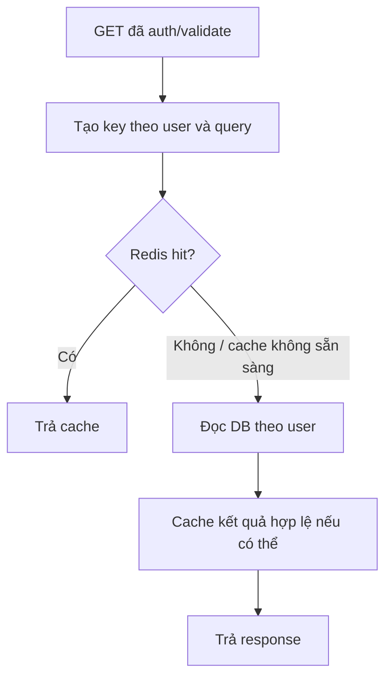

# Todo App — Kiến trúc hiện tại

Cập nhật working tree ngày **21/10/2026**. Mô tả source, chưa xác nhận runtime. Xem [báo cáo](TodoApp.md), [API](api.md) và [sequence](sequence-diagrams.md).

## 1. Tổng thể

Browser chạy React/SWR → Nginx :8080 → /api tới Express :3000 → MySQL/Redis. Frontend container phục vụ file build; browser không truy cập DB/Redis. Nginx có SPA fallback; Vite development proxy /api tới localhost:3000.

Backend chia theo layer; đây không phải microservices.

## 2. Backend

```text
backend/src/
├── app.js                 # Express, routes, health, error middleware
├── server.js              # dotenv, kết nối Redis, listen
├── routes/                # auth và todo
├── validations/           # Zod và kiểm tra ID
├── middlewares/           # auth, 404, error
├── controllers/           # HTTP input/output
├── services/              # nghiệp vụ, phối hợp cache
├── repositories/          # SQL qua mysql2/promise
├── configs/               # MySQL pool, Redis client
└── caches/
    ├── cache.js           # withCache và thao tác Redis
    └── todo.cache.js      # key và invalidation
```

Backend dùng CommonJS. Request Todo: route → requireAuth → validation → controller → service → repository/DB. Service bọc các hàm đọc bằng cache và invalidation sau ghi.

Controller không viết SQL; repository không dùng req/res; service không tạo HTTP response. Error middleware nhận lỗi qua next(error).

Pool có connectionLimit=10. Truy vấn dùng placeholder qua execute; SELECT danh sách dùng pool.query có tham số cho LIMIT/OFFSET. Filter SQL chọn từ map cố định sau validation enum. Danh sách chạy bốn COUNT và một SELECT. Index (user_id, created_at, id) đã có; chưa có EXPLAIN/benchmark trong báo cáo.

## 3. Frontend

```text
frontend/src/
├── main.jsx               # Router, SWRConfig, AuthProvider
├── App.jsx                # routes, Header, Toaster
├── pages/                 # Home, Register, Login, TodoApp
├── components/
│   ├── layout/Header.jsx
│   └── todo/              # form, card, list, search, filter, paging, trạng thái
├── hooks/
│   ├── useTodoQuery.js    # URL q/tab/page
│   ├── useTodos.js        # SWR list và page overflow
│   └── useTodoMutations.js # mutation và revalidation
├── api/                   # httpClient, todoApi
├── contexts/              # AuthContext, AuthProvider
├── lib/errorHandler.js
└── utils/todoDate.js
```

Frontend dùng ES Modules và CSS thuần. TodoApp ghép component, giữ state mở form/đang sửa. Form tạo/sửa và ô search tự giữ state nhập liệu. TodoItem dùng memo với 8 props; các callback liên quan dùng useCallback.

- SWR key: ['todos', { keyword, page, limit, filterTab }].
- URL q/tab/page giữ lựa chọn khi F5 và Back/Forward.
- Mutation gọi mutate lọc các key Todo để revalidate; chưa có optimistic update.
- useTodos điều chỉnh trang vượt giới hạn qua onPageOverflow.
- keepPreviousData bật, nhưng TodoList ưu tiên skeleton khi isLoading; cần kiểm thử đổi key.
- SWR key chưa có userId; AuthProvider xóa cache khi logout/401, cần kiểm thử đổi tài khoản.

httpClient bọc fetch, credentials, JSON, 204 và ApiError; timeout mặc định 10 giây bằng AbortSignal.timeout, kết hợp signal ngoài bằng AbortSignal.any. Abort chủ động giữ nguyên; timeout/mạng/HTTP lỗi được chuẩn hóa.

SWRConfig xử lý lỗi tải qua handleError silent và banner; không retry 4xx/abort, lỗi còn lại có retry giới hạn. Login/Register vẫn fetch trực tiếp và toast riêng.

## 4. Xác thực và quyền

JWT trong HttpOnly cookie hạn một ngày. AuthProvider gọi /me khi mount, AbortController hủy khi cleanup. /me không refresh token; logout không thu hồi bản JWT đã sao chép.

Mọi route Todo dùng requireAuth, verify HS256. SQL chi tiết/sửa/xóa lọc id/user_id, cache key chứa userId. App.jsx chưa có ProtectedRoute; sự kiện 401 xóa user/cache và chuyển login sau phản hồi API.

## 5. Cache

withCache tách cơ chế Redis khỏi hàm lấy dữ liệu. Hàm đọc DB vẫn có I/O, không phải pure function.



| Loại | Key |
| --- | --- |
| Chi tiết | todo:{userId}:{todoId} |
| Version | todos:ver:{userId} |
| Danh sách | todos:{userId}:v{version}:{queryHash} |

Hash là 16 ký tự hex đầu của SHA-1 trên [page, limit, keyword, filterTab]. Key dữ liệu có TTL mặc định 60 giây; version chưa có TTL. Không cache null/undefined.

Tạo tăng version; sửa/xóa DEL chi tiết rồi tăng version. Key danh sách cũ tự hết TTL. DB ghi trước invalidation; lỗi cache không rollback DB, nên có thể còn dữ liệu cũ khi invalidation lỗi hoặc đọc/ghi đồng thời.

Redis client disableOfflineQueue, connectTimeout và reconnectStrategy. server.js không await connect Redis; Compose vẫn chờ Redis healthy trước khi start backend. Fallback runtime và điều kiện khởi động Compose là hai hành vi khác nhau.

## 6. Dữ liệu và triển khai

Migration 001_init.sql có users/todos/tags/todo_tags; tag chưa có API/UI. DATE nghiệp vụ dùng giờ Việt Nam, DATETIME và timezone connection cần thống nhất thêm.

Compose chính publish 8080; dev override publish MySQL 3307 và bật backend development. MySQL dùng volume, SQL init chỉ chạy khi data directory trống. SQL ghi cứng todo_app.

Backend chạy user node; frontend multi-stage build và Nginx. Health backend chỉ SELECT 1. Nginx hiện HTTP; production bật Secure cookie, cần kiểm thử cách truy cập demo và cấu hình HTTPS khi triển khai.

## 7. Còn cần hoàn thiện

Test API/browser/cache/môi trường sạch; ProtectedRoute và chờ auth; phân vùng SWR theo user; kiểm chứng loading; thống nhất client cho auth, timezone và dọn debug log. Chưa có refresh token, token revocation, tag API/UI, admin hoặc chia sẻ.
