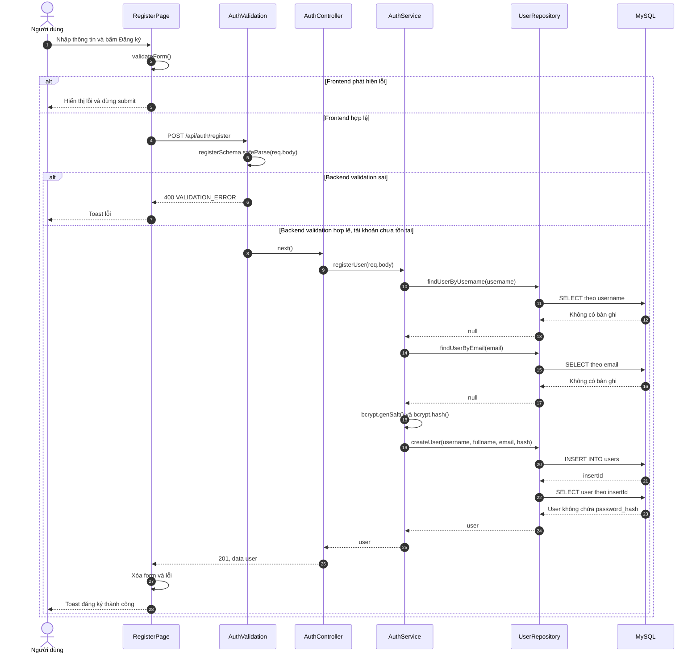
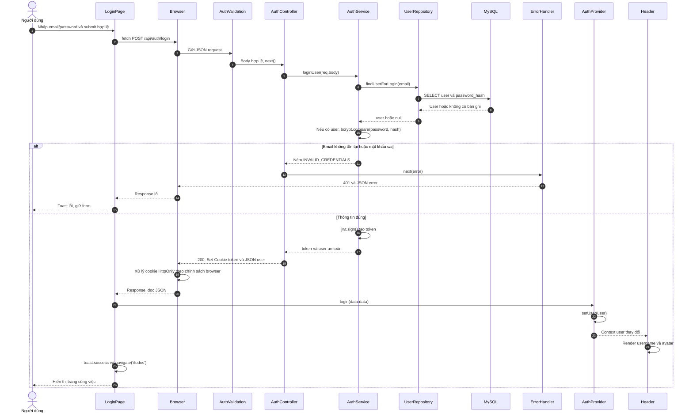
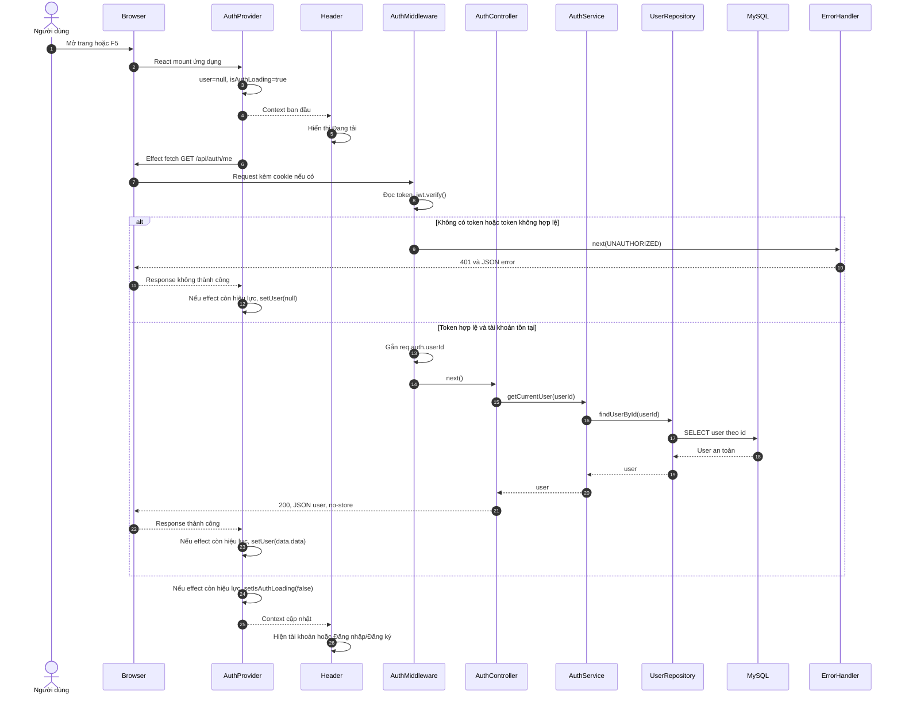
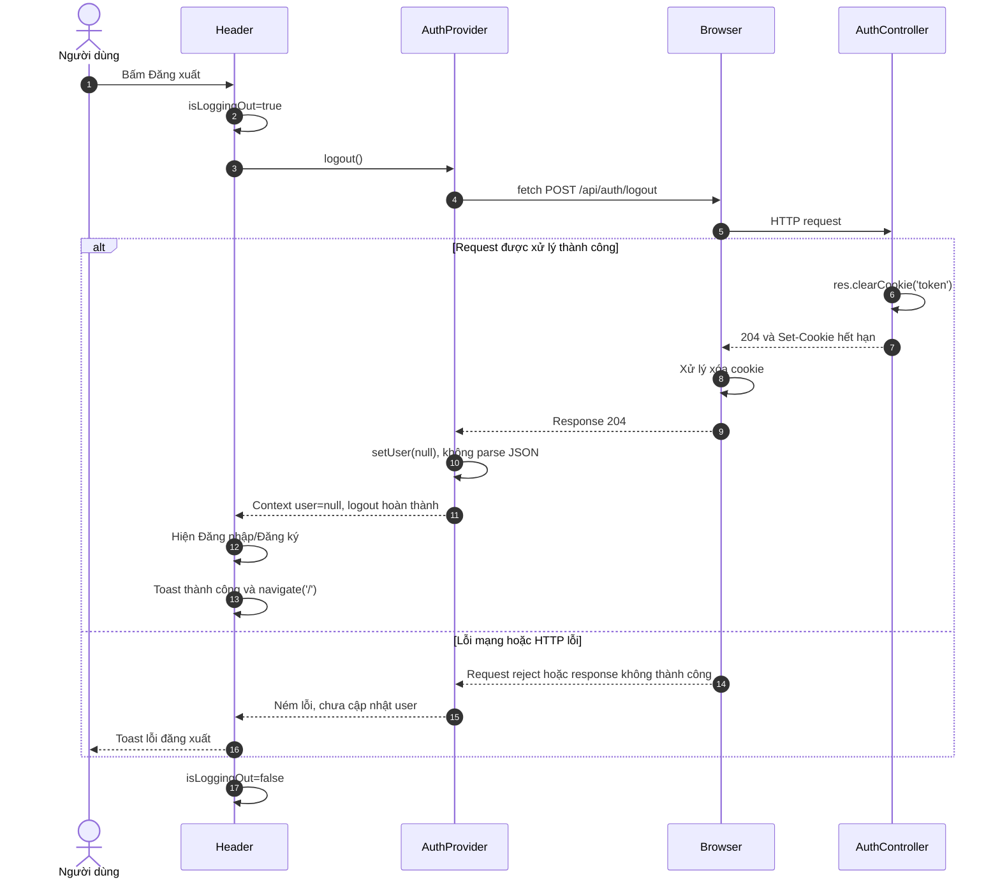

# Kịch bản use case và biểu đồ tuần tự Todo App

Cập nhật: **15/10/2026**. Cách trình bày tham khảo mẫu báo cáo phân tích thiết kế người thực hiện cung cấp: Use case, Actor, Tiên điều kiện, Hậu điều kiện, Kịch bản chính và Ngoại lệ; mỗi kịch bản có biểu đồ tuần tự ngay bên dưới.

Mẫu báo cáo có bảng kịch bản nghiệp vụ; biểu đồ tuần tự dưới đây được bổ sung cho Todo App bằng Mermaid. Các tên tham gia bám theo React SPA và Express 3-layer, không tạo thêm lớp chỉ để giống tên trong báo cáo môn học.

**Trạng thái:** bốn luồng auth bên dưới đã có code, chờ kiểm tra end-to-end theo [timeline](timeline.md). Diagram mô tả luồng ở mức thiết kế/đọc source, không phải bằng chứng tính năng đã được nghiệm thu. HTTP status và JSON chi tiết xem [api.md](api.md).

## Mục lục

1. [UC01 — Đăng ký tài khoản](#uc01--đăng-ký-tài-khoản)
2. [UC02 — Đăng nhập và cập nhật Header](#uc02--đăng-nhập-và-cập-nhật-header)
3. [UC03 — Khôi phục trạng thái đăng nhập khi mở hoặc refresh trang](#uc03--khôi-phục-trạng-thái-đăng-nhập-khi-mở-hoặc-refresh-trang)
4. [UC04 — Đăng xuất](#uc04--đăng-xuất)
5. [Các use case Todo cần bổ sung](#các-use-case-todo-cần-bổ-sung)

## Quy ước đối tượng tham gia

| Đối tượng | Vai trò | Liên hệ source |
|---|---|---|
| Người dùng | Actor thao tác trên trình duyệt | Không phải component |
| Browser | Quản lý cookie, gửi request và nhận response | Cookie token HttpOnly |
| RegisterPage/LoginPage/Header | Giao diện tương tác | frontend/src/pages và components/layout |
| AuthProvider | State user và thao tác login/logout dùng chung | frontend/src/contexts/AuthProvider.jsx |
| AuthValidation | Kiểm tra body ở backend | backend/src/validations/auth.validation.js |
| AuthMiddleware | Xác minh JWT cookie | backend/src/middlewares/auth.middleware.js |
| AuthController | Xử lý HTTP và trả response | backend/src/controllers/auth.controller.js |
| AuthService | Nghiệp vụ tài khoản, bcrypt và tạo token | backend/src/services/auth.service.js |
| UserRepository | Truy vấn SQL qua MySQL pool | backend/src/repositories/user.repository.js |
| ErrorHandler | Chuyển lỗi thành response HTTP/JSON | backend/src/middlewares/error.middleware.js |
| MySQL | Lưu users và todos | Migration 001/002 |

`auth.route.js` nối request tới validation/middleware/controller. Vite proxy chuyển `/api` tới backend khi development. Hai phần chuyển tiếp này được lược khỏi lifeline để tập trung vào các lời gọi xử lý; chúng vẫn nằm trong luồng thực thi.

## UC01 — Đăng ký tài khoản

*Bảng 1. Kịch bản đăng ký tài khoản*

| Thuộc tính | Nội dung |
|---|---|
| Use case | Đăng ký tài khoản |
| Actor | Người dùng chưa có tài khoản |
| Tiên điều kiện | Người dùng mở `/register`; frontend/backend hoạt động, MySQL có schema phù hợp |
| Hậu điều kiện thành công | Có bản ghi user mới với username/email duy nhất; mật khẩu được hash; fullname có thể NULL; người dùng được thông báo thành công. Đăng ký hiện không tự đăng nhập hoặc tự chuyển trang |
| Kịch bản chính | 1. Người dùng nhập username, email, password, xác nhận password; fullname tùy chọn. 2. Người dùng bấm Đăng ký. 3. Frontend kiểm tra dữ liệu, chặn gửi lặp và gửi request không chứa confirmPassword. 4. Backend kiểm tra schema, chuẩn hóa dữ liệu theo code hiện tại và kiểm tra username/email trùng. 5. Backend hash mật khẩu và lưu user. 6. Backend lấy lại user an toàn và trả 201. 7. Frontend hiện toast thành công, xóa dữ liệu form và lỗi cũ |
| Ngoại lệ | 3a. Frontend phát hiện lỗi: hiển thị lỗi, không gọi API. 4a. Backend validation sai: trả 400, không gọi service. 4b. Username/email đã tồn tại: trả 409 với mã lỗi tương ứng. 5a. Hai request trùng nhau: unique constraint chặn một request, service đổi ER_DUP_ENTRY thành lỗi 409. 5b. Lỗi DB hoặc code: error handler trả 500; cần kiểm tra DB nếu lỗi xảy ra sau INSERT vì luồng hiện chưa có transaction toàn bộ createUser. 6a. Mất kết nối/response không hợp lệ: frontend báo lỗi, không khẳng định tài khoản chưa được tạo |
| Task liên quan | A01, A04 |

*Hình 1. Biểu đồ tuần tự đăng ký tài khoản — luồng thành công và validation backend sai*

Nhánh username/email trùng dùng chung luồng lỗi: service ném lỗi → controller `next(error)` → ErrorHandler trả 409. Không trả password/hash cho frontend.

## UC02 — Đăng nhập và cập nhật Header

*Bảng 2. Kịch bản đăng nhập*

| Thuộc tính | Nội dung |
|---|---|
| Use case | Đăng nhập và hiển thị tài khoản trên Header |
| Actor | Người dùng đã có tài khoản |
| Tiên điều kiện | Người dùng mở `/login`; phiên kiểm tra ban đầu đã kết thúc; backend có JWT_SECRET và user có password hash hợp lệ |
| Hậu điều kiện thành công | Browser lưu JWT trong cookie token; Context giữ thông tin user; Header hiện username/avatar và nút đăng xuất; route đổi sang `/todos` bằng SPA |
| Kịch bản chính | 1. Người dùng nhập email/password và bấm Đăng nhập. 2. Frontend kiểm tra dữ liệu và gửi POST login. 3. Backend validation, tìm user và so sánh password bằng bcrypt.compare. 4. Backend tạo JWT hạn 1 ngày, trả Set-Cookie và JSON user. 5. Browser xử lý cookie, frontend nhận user. 6. LoginPage gọi login(data.data), Provider cập nhật user và chia sẻ Context mới. 7. Header render username/avatar; React Router chuyển `/todos` không tải lại toàn trang |
| Ngoại lệ | 2a. Frontend sai: dừng trước fetch. 3a. Backend validation sai: 400. 3b. Email không tồn tại hoặc mật khẩu sai: cùng lỗi 401 INVALID_CREDENTIALS, không cấp cookie đăng nhập. 4a. Lỗi ký token/cấu hình/DB: 500. 5a. Request hoặc đọc response lỗi: báo thất bại, không cập nhật Context như đã login |
| Task liên quan | A02 |

*Hình 2. Biểu đồ tuần tự đăng nhập và cập nhật Header*

Thứ tự commit giao diện do React lên lịch, không bảo đảm Header đã vẽ xong trước khi navigate chạy. Điều quan trọng là cả Header và route mới đọc cùng Context; không có reload hoặc request /me bắt buộc ngay sau login.

## UC03 — Khôi phục trạng thái đăng nhập khi mở hoặc refresh trang

*Bảng 3. Kịch bản khôi phục trạng thái tài khoản*

| Thuộc tính | Nội dung |
|---|---|
| Use case | Nhận diện lại user từ cookie và hiển thị Header |
| Actor | Người dùng mở hoặc refresh ứng dụng; hệ thống tự kiểm tra |
| Tiên điều kiện | AuthProvider bọc App; Browser có thể có hoặc không có cookie token |
| Hậu điều kiện thành công | Với cookie hợp lệ và tài khoản còn tồn tại, Context nhận user từ backend và Header hiện tài khoản |
| Kịch bản chính | 1. Người dùng mở trang hoặc nhấn F5. 2. AuthProvider khởi tạo user=null, isAuthLoading=true; Header hiện Đang tải. 3. Sau commit ban đầu, effect gọi GET /me kèm cookie. 4. Backend xác minh token, gắn req.auth.userId. 5. Controller/service/repository tìm user theo ID. 6. Backend trả 200 với user, Cache-Control: no-store. 7. Provider đặt user=data.data và kết thúc loading; Header cập nhật |
| Ngoại lệ | 4a. Không có token, token sai/hết hạn: trả 401; frontend user=null, Header hiện Đăng nhập/Đăng ký. 5a. User đã bị xóa: 401. 5b. DB/server lỗi: 500; code frontend hiện cũng đặt user=null, chưa phân biệt lỗi hệ thống với hết phiên trên giao diện. 3a. Effect được cleanup trước khi request trả về: ignore=true, bỏ qua cập nhật state từ effect đó. Request HTTP không tự bị hủy |
| Task liên quan | A02; A03 cho việc bảo vệ route Todo |

*Hình 3. Biểu đồ tuần tự kiểm tra phiên khi refresh*

Tài khoản không còn tồn tại và lỗi DB dùng luồng controller → ErrorHandler tương tự UC02. /me là kiểm tra phiên hiện tại, không phải API refresh token; project chưa có refresh token.

## UC04 — Đăng xuất

*Bảng 4. Kịch bản đăng xuất*

| Thuộc tính | Nội dung |
|---|---|
| Use case | Đăng xuất tài khoản hiện tại |
| Actor | Người dùng đang có thông tin tài khoản hiển thị trên Header |
| Tiên điều kiện | Header có nút Đăng xuất; frontend/backend hoạt động |
| Hậu điều kiện thành công | Browser xóa cookie token theo response; Context user=null; Header hiện Đăng nhập/Đăng ký; giao diện chuyển trang chủ |
| Kịch bản chính | 1. Người dùng bấm Đăng xuất. 2. Header khóa nút, gọi logout() từ Context. 3. Provider gửi POST /logout kèm cookie. 4. Controller clearCookie với các thuộc tính phù hợp và trả 204 không có body. 5. Browser xử lý xóa cookie; Provider kiểm tra response.ok và đặt user=null. 6. Header hiện trạng thái chưa đăng nhập, toast thành công và navigate('/'). 7. Nút kết thúc trạng thái chờ |
| Ngoại lệ | 3a. Mất mạng hoặc server trả lỗi: frontend báo lỗi và chưa tự xóa user khỏi Context. 4a. Cookie đã hết hạn/không tồn tại: endpoint vẫn cho phép xóa cookie và trả 204. 5a. Không gọi response.json() vì 204 không có body. Giới hạn: bản JWT đã được sao chép trước logout còn hiệu lực đến khi hết hạn; chưa có thu hồi token server-side |
| Task liên quan | A02 |

*Hình 4. Biểu đồ tuần tự đăng xuất*

## Các use case Todo cần bổ sung

Các mục sau là **thiết kế dự kiến, chưa có API trong source ngày 15/10**. Hoàn thành bảng kịch bản rồi cập nhật diagram cùng với từng luồng, theo format UC01–UC04.

| Mã | Use case | Actor | Điều kiện chính và ngoại lệ cần mô tả | Task |
|---|---|---|---|---|
| UC05 | Tạo công việc | User đã đăng nhập | title hợp lệ; user_id lấy từ JWT; 201; lỗi validation 400 hoặc auth 401 | T01–T05 |
| UC06 | Xem danh sách, phân trang | User đã đăng nhập | Chỉ Todo của mình; page/pageSize; total; trang rỗng; response cũ khi đổi trang | T03–T05, P01–P04 |
| UC07 | Xem chi tiết Todo có cache | User đã đăng nhập | requireAuth; key theo userId/todoId; hit/miss; TTL; 404; Redis lỗi fallback DB | T07, C01–C05 |
| UC08 | Sửa hoặc hoàn thành Todo | Chủ sở hữu Todo | PATCH fields hợp lệ; id + user_id; invalidation sau ghi; 404 khi khác chủ | T06–T10, C03 |
| UC09 | Xóa Todo | Chủ sở hữu Todo | Xác nhận xóa; 204; frontend không parse JSON; xóa cache; item cuối trang | T08–T10, P03, C03 |

## Cách cập nhật

1. Sửa bảng kịch bản trước: đầu vào, hành động, hậu điều kiện và ngoại lệ.
2. Đối chiếu contract với api.md, tên hàm với source, deadline với timeline.md.
3. Sửa Mermaid ngay dưới use case, giữ message thể hiện ai gọi ai và dữ liệu nào được trả lại.
4. Ghi rõ diagram mô tả code hiện có hay thiết kế dự kiến. Sau khi chạy thử mới thêm bằng chứng nghiệm thu vào timeline.
5. Không ghi password, JWT, secret hoặc thông tin cá nhân thật vào ví dụ/ảnh chụp.

Đọc diagram bằng Markdown Preview có hỗ trợ Mermaid hoặc trên GitHub. Nếu trình xem không render Mermaid, khối mã vẫn là nguồn để sửa diagram; lỗi hiển thị ở trình xem không chứng minh luồng code sai.
