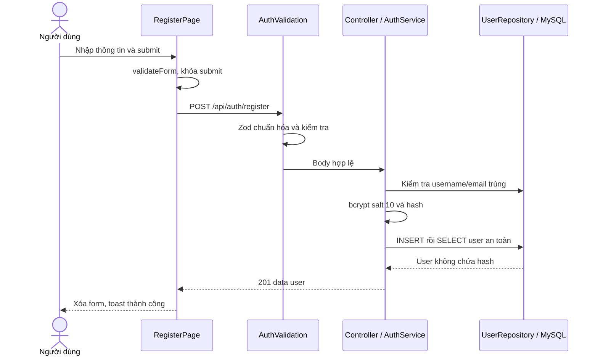
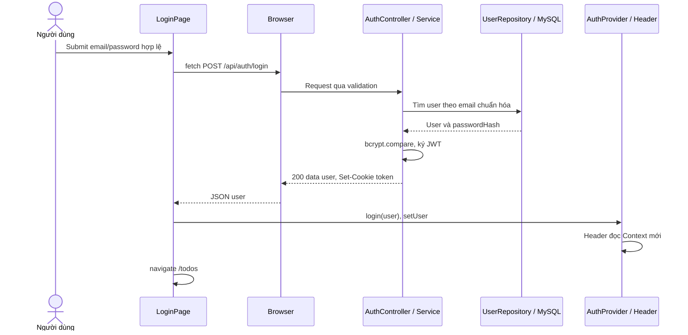
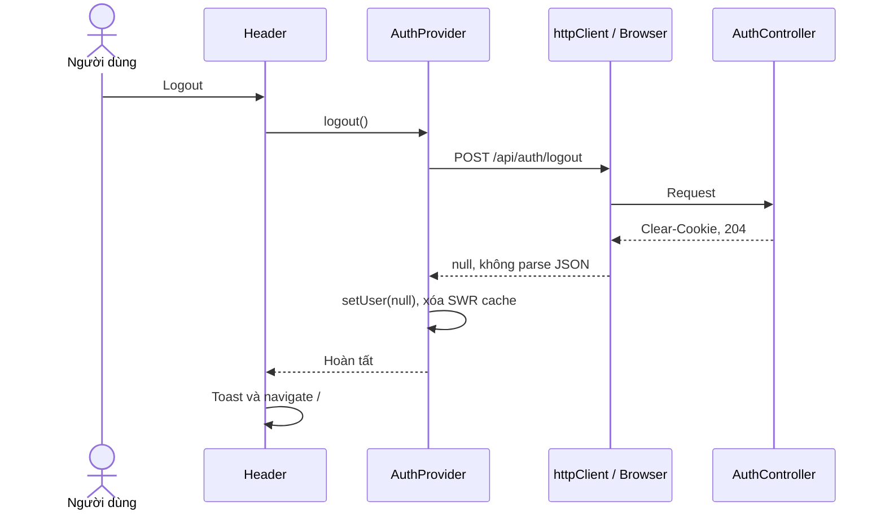
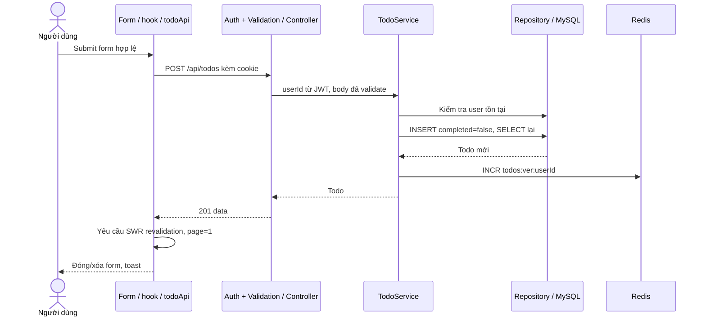
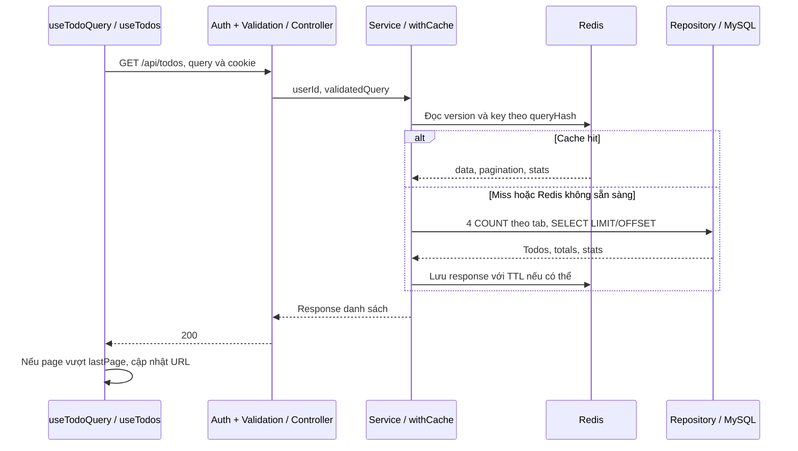
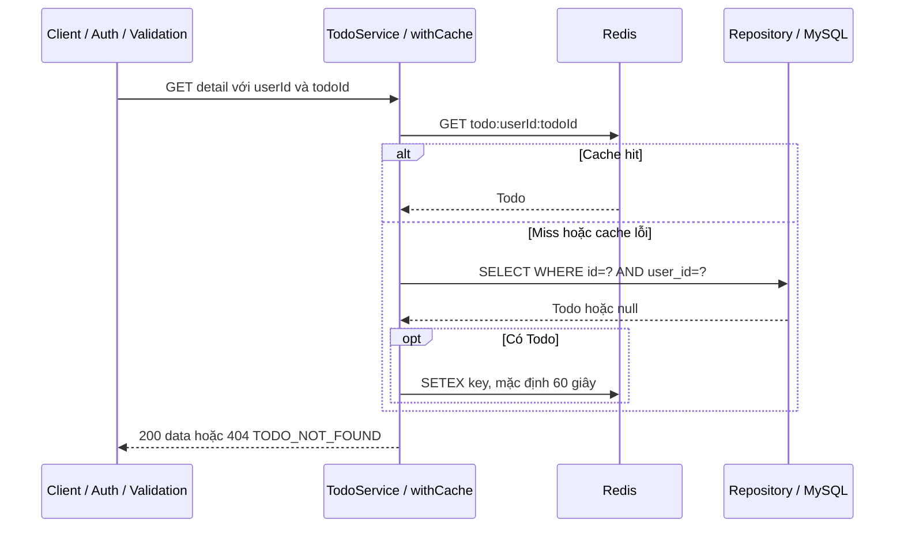
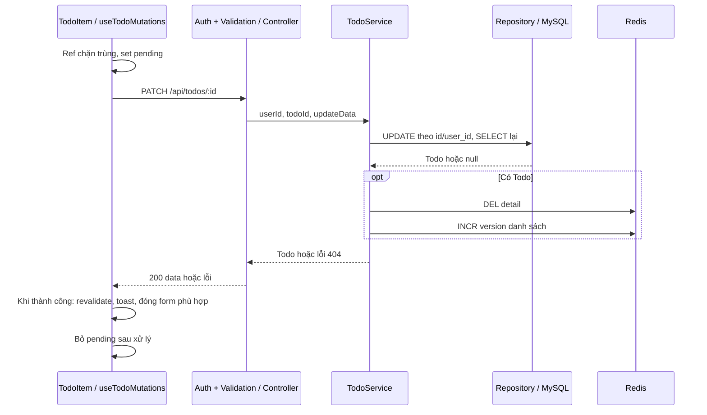
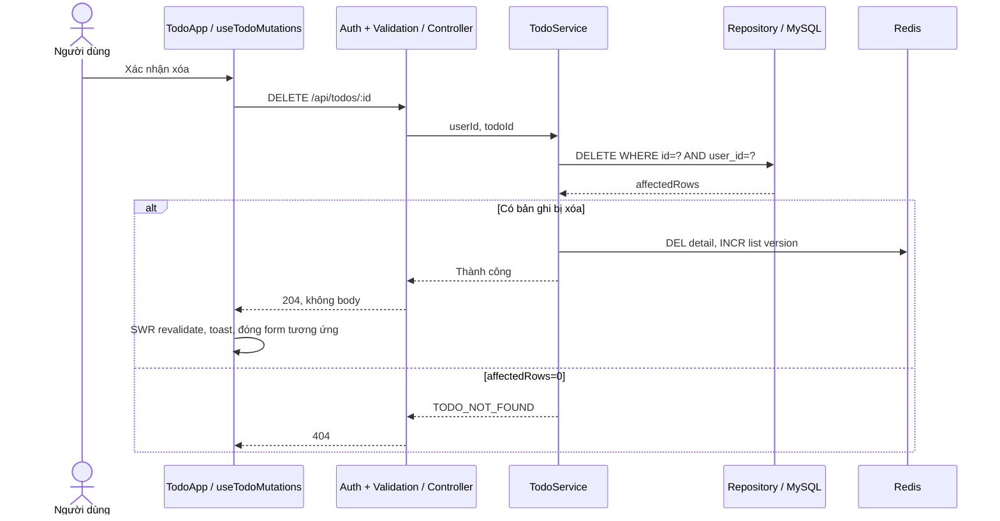

# Todo App — Use case và sequence diagram

Cập nhật **21/10/2026**, mô tả implementation hiện tại theo source. Diagram không phải bằng chứng đã chạy thành công. [API](api.md) là nơi ghi validation/status chi tiết; [timeline](timeline.md) ghi kết quả nghiệm thu khi có.

Các bước route/proxy có thể được lược để sơ đồ dễ đọc. Cache hit có thể bỏ qua repository; quyền truy cập vẫn dựa trên middleware và key theo user.

## UC01 — Đăng ký

| Thuộc tính | Nội dung |
| --- | --- |
| Actor | Người chưa có tài khoản |
| Tiền điều kiện | Mở /register, backend và DB sẵn sàng |
| Đầu vào | username, email, password; fullname tùy chọn; confirmPassword chỉ dùng UI |
| Thành công | User mới lưu hash, response 201; UI xóa form và thông báo, không tự login |
| Ngoại lệ | Frontend chặn dữ liệu sai; backend 400; trùng username/email 409; lỗi hệ thống 500 |



Unique constraint chặn request trùng đồng thời; service chuyển ER_DUP_ENTRY thành 409. INSERT và SELECT chưa được bọc chung transaction; lỗi sau INSERT không đồng nghĩa DB chưa tạo user.

## UC02 — Đăng nhập

| Thuộc tính | Nội dung |
| --- | --- |
| Actor | Người có tài khoản |
| Tiền điều kiện | Trang login; frontend hoàn tất kiểm tra phiên ban đầu |
| Thành công | Cookie JWT một ngày, Context user, Header cập nhật, navigate /todos |
| Ngoại lệ | Validation 400; email/password sai 401 INVALID_CREDENTIALS; lỗi hệ thống |



Cookie HttpOnly, SameSite=Lax, Secure khi production. Frontend không đọc JWT. LoginPage hiện dùng fetch trực tiếp, không qua httpClient chung.

## UC03 — Khôi phục user khi mở/F5

| Thuộc tính | Nội dung |
| --- | --- |
| Actor | Hệ thống khi ứng dụng mount |
| Tiền điều kiện | AuthProvider nằm trong Router/SWRConfig |
| Thành công | User từ /me được đưa vào Context |
| Ngoại lệ | Token thiếu/sai/hết hạn hoặc user mất: 401; mạng/DB lỗi hiện cũng dẫn tới user=null |

```mermaid
sequenceDiagram
    participant F as AuthProvider
    participant H as httpClient / Browser
    participant M as requireAuth
    participant A as AuthController / Service
    participant D as UserRepository / MySQL
    F->>F: user=null, isAuthLoading=true
    F->>H: GET /api/auth/me với AbortController
    H->>M: Cookie token
    M->>M: verify HS256, gắn userId
    M->>A: next
    A->>D: findUserById
    D-->>A: User an toàn
    A-->>H: 200 data, Cache-Control no-store
    H-->>F: Kết quả
    F->>F: Nếu chưa abort: setUser, kết thúc loading
    Note over F,H: Cleanup gọi abort; không cập nhật state từ request đã hủy
```

/me không refresh token. /todos chưa có route guard chờ auth; hook tải Todo hiện có thể chạy cùng lúc với /me.

## UC04 — Đăng xuất

| Thuộc tính | Nội dung |
| --- | --- |
| Actor | Người dùng có nút logout trên Header |
| Thành công | Backend xóa cookie, 204; frontend xóa user/cache, về trang chủ |
| Ngoại lệ | Request lỗi: chưa thực hiện nhánh thành công; 401 qua handler có thể xử lý phiên riêng |



Endpoint không bắt buộc token hợp lệ. Logout không thu hồi bản JWT đã sao chép; cache SWR được xóa nhưng Redis không bị xóa toàn bộ khi logout.

## UC05 — Tạo Todo

| Thuộc tính | Nội dung |
| --- | --- |
| Actor | User đã xác thực |
| Đầu vào | title, description/dueDate tùy chọn |
| Thành công | 201, Todo thuộc user; completed=false; version danh sách tăng |
| Ngoại lệ | 400 body sai/field lạ; 401; lỗi DB hoặc mạng |



Create giữ keyword/tab; item mới có thể không khớp bộ lọc. Hook create gọi revalidation nhưng không await nó. Chưa có idempotency key; mất phản hồi sau ghi DB không chứng minh chưa tạo dữ liệu.

## UC06 — Danh sách, tìm kiếm, lọc, phân trang

| Thuộc tính | Nội dung |
| --- | --- |
| Actor | User đã xác thực |
| Đầu vào | page/limit/keyword/filterTab; UI q/tab/page nằm trên URL |
| Thành công | 200 data + pagination + stats, chỉ dữ liệu của user |
| Ngoại lệ | 400 query sai/field lạ; 401; lỗi hệ thống; trang vượt dữ liệu trả mảng rỗng |



SWR có thể phục vụ dữ liệu frontend mà chưa phát sinh request backend. keepPreviousData đã bật nhưng TodoList vẫn ưu tiên skeleton khi isLoading. Chưa xác nhận hành vi loading qua runtime.

## UC07 — Đọc chi tiết có cache

| Thuộc tính | Nội dung |
| --- | --- |
| Actor | Client đã xác thực gọi API; chưa có màn hình chi tiết riêng |
| Thành công | 200 Todo của user; cache key phân tách theo user |
| Ngoại lệ | ID sai 400; thiếu phiên 401; không có/khác chủ 404, không cache null |



Cache không lưu password/hash. Middleware chạy trước cache; key userId lấy từ token đã verify.

## UC08 — Sửa hoặc bật/tắt hoàn thành

| Thuộc tính | Nội dung |
| --- | --- |
| Actor | Chủ sở hữu Todo |
| Đầu vào | PATCH ít nhất một field hợp lệ |
| Thành công | 200, DB cập nhật, DEL chi tiết, tăng version list, SWR revalidate |
| Ngoại lệ | Body/ID sai 400; auth 401; không có/khác chủ 404; lỗi hệ thống |



completed_date được cập nhật theo trạng thái cũ trước khi gán completed. Gửi true lần nữa không thay ngày hoàn thành. Chưa có optimistic update.

## UC09 — Xóa Todo

| Thuộc tính | Nội dung |
| --- | --- |
| Actor | Chủ sở hữu Todo |
| Kích hoạt | Bấm Xóa và xác nhận window.confirm |
| Thành công | DELETE theo id/user_id, 204; invalidation và SWR revalidation |
| Ngoại lệ | Hủy xác nhận không gửi request; 400/401/404; lỗi DB/mạng |



Nếu trang trở thành vượt giới hạn, response danh sách sau đó kích hoạt onPageOverflow. Invalidation là sau ghi DB, lỗi Redis không rollback DB; cần ghi nhận giới hạn dữ liệu cũ.

## Kiểm chứng và bảo trì

- Các diagram mô tả luồng tuần tự chính; nhánh lỗi không vẽ hết được mô tả trong bảng/notes và API.
- Không coi có diagram là đã test. Ghi bằng chứng vào timeline, nhất là ownership hai tài khoản, cache, lỗi mạng và request đồng thời.
- Khi source đổi, cập nhật bảng use case và sơ đồ cùng API.
- Ảnh PNG trong thư mục docs là tài liệu tham khảo trước đó; Mermaid trong file này là bản mô tả hiện tại. Không dùng ảnh cũ để suy ra trạng thái code.
